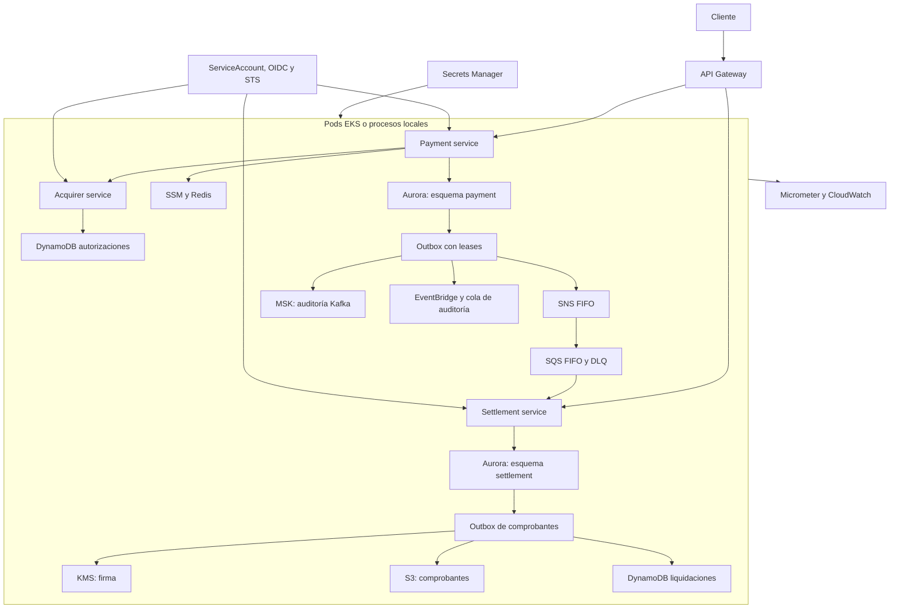

# Axiz Payments: resiliencia y arquitectura AWS local con Floci

Se implementa una PoC de procesamiento de pagos que permite **observar y probar cómo se conserva la consistencia financiera ante fallos de red, respuestas tardías, duplicación de solicitudes y caída de dependencias**. Se combinan Java 25, Spring Boot 4.1, Resilience4j y servicios AWS emulados por Floci. Se utiliza como base la plantilla hexagonal adjunta; se conserva la separación entre dominio, casos de uso, puertos, adaptadores y configuración, y se amplía a tres contextos de negocio bajo `pe.axiz`.

El caso funcional contempla un comercio que solicita una autorización mediante un token, un adquirente que decide la operación y un servicio de liquidación que registra los asientos y publica un comprobante firmado. Se utilizan datos sintéticos. No se reciben PAN, CVV ni datos personales.

## Comportamiento funcional

- Se valida el monto, la moneda y la política del comercio almacenada en Parameter Store y cacheada en Redis.
- Se reserva el pago con una clave de idempotencia persistente por comercio. Se devuelve la operación existente ante un replay y HTTP 409 si cambia su contenido.
- Se solicita autorización al adquirente con el mismo identificador en todos los intentos. DynamoDB evita duplicar la autorización.
- Se registra `AUTHORIZED` o `DECLINED` y se escribe el outbox en la misma transacción PostgreSQL. Una respuesta incierta conserva `UNKNOWN`; nunca se transforma una indisponibilidad en autorización.
- Se entrega cada decisión a SNS, MSK y EventBridge con reintentos independientes. SNS FIFO distribuye a SQS FIFO; EventBridge alimenta una cola de auditoría.
- Se procesa SQS después de persistir un inbox deduplicado, los asientos balanceados y el outbox de comprobantes. Se elimina el mensaje después del commit.
- Se firma el comprobante mediante KMS, se almacena en S3 y se actualiza la proyección DynamoDB. Una caída durante este tramo se recupera desde el outbox.
- Se concilian pagos pendientes mediante consulta al adquirente. Un pago no encontrado permanece incierto y requiere seguimiento; no se vuelve a autorizar desde la conciliación.

## Caso tecnológico y políticas de resiliencia

Resilience4j se integra mediante composición explícita de sus APIs. Se evitan dependencias de un starter de otra generación de Spring y la ambigüedad de orden de aspectos.

| Mecanismo | Aplicación | Comportamiento observable |
|---|---|---|
| Circuit breaker | Comunicación con adquirente | Ventana de 10 intentos, mínimo de 4, umbral de fallos de 50%, llamadas lentas de 600 ms y umbral de lentitud de 60%. Se habilitan dos sondas HALF_OPEN y transición automática. |
| Retry | Intentos de autorización y consulta | Se reintentan fallos transitorios y timeout con backoff exponencial desde 100 ms y jitter de 50%. Se conserva el identificador financiero. No se reintentan reglas comerciales ni rechazo por capacidad. |
| TimeLimiter | Cada intento saliente | Se cancela el Future al vencer el plazo; HttpClient aplica también un deadline propio. Se verifica la interrupción de trabajo en las pruebas. |
| Semaphore bulkhead | Trabajo HTTP concurrente | Se limita el número de llamadas activas sin cola de espera. El permiso se conserva mientras el trabajo continúa y se libera al finalizar. |
| Thread pool bulkhead | Publicación de outbox | Se aíslan dos hilos y una cola de ocho tareas. Se mantiene el evento pendiente cuando se agota la capacidad. |
| Rate limiter | Ingreso y llamadas salientes | Se limita la tasa por instancia. HTTP 429 incluye `Retry-After`. Los reintentos cuentan como intentos salientes. |
| Degradación controlada | Redis | Se consulta SSM cuando la caché falla; se conserva la política comercial como fuente autoritativa. |
| Recuperación durable | Outbox e inbox | Se emplean leases de 60 segundos, `SKIP LOCKED`, reintentos persistidos y confirmación posterior al commit. |
| Observabilidad | Micrometer, Prometheus y CloudWatch | Se exponen métricas y un buffer acotado de los últimos 100 eventos de resiliencia. Se propaga `X-Correlation-Id`. |

El orden de ejecución es `Retry → CircuitBreaker → RateLimiter → TimeLimiter → SemaphoreBulkhead → HTTP`. El circuito observa cada intento físico; la tasa de fallos no representa operaciones financieras distintas. El presupuesto total puede incluir tres deadlines y dos pausas con jitter. Un rechazo financiero es una respuesta válida, no un fallo de disponibilidad.

Los controles de tasa y concurrencia son locales a cada instancia. Se utiliza Redis para políticas de comercio, no para afirmar un límite global de solicitudes.

## Servicios y tecnologías

| Tecnología | Función en la PoC |
|---|---|
| Java 25 y Spring Boot 4.1.1 | REST, validación, hilos virtuales, cierre ordenado y Actuator. Spring Framework 7.0.9 se resuelve desde el BOM de Boot. |
| Resilience4j 2.4.0 | Circuit breaker, retry, time limiter, bulkheads, rate limiters y métricas. |
| AWS SDK v2 2.55.11 | Clientes compatibles con protocolos AWS, firma SigV4 y renovación de sesiones STS. |
| Floci 2.1.0 | Emulación del plano de control y APIs AWS; ejecución real de los motores de base de datos, caché, Kafka y Kubernetes. |
| API Gateway HTTP API | Entrada común para pagos, conciliación y consultas de liquidación. Se reenvía la clave de API al servicio. |
| Aurora PostgreSQL emulado | Registro transaccional, outbox, inbox y contabilidad. Se ejecuta PostgreSQL 18.6; no se reproduce el almacenamiento distribuido de Aurora. |
| SQS y SNS FIFO | Distribución de decisiones, visibilidad, confirmación y DLQ tras cinco entregas fallidas. |
| DynamoDB | Autorizaciones idempotentes con escritura condicional y lectura consistente; proyección de liquidaciones. |
| S3 y KMS | Comprobantes con clave determinista, versionado y firma RSA-PSS-SHA256. |
| Secrets Manager y SSM | Claves de API e internas y política del comercio. |
| MSK emulado | Publicación Kafka con clave de pago, `acks=all` e idempotencia del productor; Floci ejecuta Redpanda 26.2.3. |
| ElastiCache emulado | Caché de políticas mediante Redis 8.8.3 y TTL de 30 segundos. |
| EKS, IAM y STS | Pods en k3s 1.35.9, ServiceAccounts independientes, trust policies por sujeto y sesiones temporales. |
| VPC y subnets | Metadatos de red requeridos por EKS y MSK; el tráfico local circula por la red Docker. |
| EventBridge y CloudWatch | Auditoría de decisiones, métricas por servicio y alarma de volumen de solicitudes. |
| Flyway 12.4.0 | Migraciones versionadas como único mecanismo de creación de tablas. |
| Maven 3.10.0 y Spotless | Compilación reproducible y formato Google Java Format 1.33.0. |

Se incluyen únicamente servicios relacionados con identidad, procesamiento, persistencia, mensajería, auditoría y operación del caso. No se aprovisiona una segunda base RDS cuando se utiliza el clúster Aurora emulado.

## Arquitectura



Cada servicio mantiene su dominio y sus puertos. Se comparte un clúster físico para reducir el coste local, con esquemas y usuarios separados. No se consulta el esquema de otro contexto desde un servicio.

## Estructura del proyecto

| Carpeta o archivo | Contenido |
|---|---|
| `platform/` | Identidad AWS, datasource IAM, filtros de autenticación, correlación, catálogo REST y métricas. |
| `payment-service/` | Agregado de pago, Money, casos de uso, adaptadores JDBC/HTTP/SSM/Redis y publicación outbox. |
| `acquirer-service/` | Dominio de autorización, persistencia DynamoDB y simulador controlado de fallos. |
| `settlement-service/` | Consumo SQS, inbox, contabilidad y publicación de comprobantes. |
| `infrastructura/` | Compose, imágenes base, aprovisionamiento, despliegue EKS, verificaciones AWS y ejemplos JSON de requests/responses. |
| `datasets/` | Pagos sintéticos y carga idempotente mediante REST. |
| `scripts/` | Construcción, ejecución en host, pruebas y catálogo de rutas. |
| `validation/` | Evidencia de compilación y pruebas en formato de salida de herramientas. |
| `.env.example`, `application.yml.example` | Ejemplos comentados de configuración. |
| `pom.xml`, `mvnw` | Reactor Maven y lanzador Linux con verificación SHA-512 de la distribución. |

## Código principal

`PaymentService` implementa los casos de uso sin dependencias de Spring. `Money` normaliza la precisión monetaria y `Payment` impide reemplazar una decisión final incompatible. `JdbcPaymentStore` reserva la idempotencia con una restricción única y persiste decisión y outbox en una transacción.

`HttpAuthorizationAdapter` envía el mismo identificador en cada intento. `ResiliencePolicies` conserva registros compartidos por servicio, compone las políticas y registra sus eventos. `OutboxPublisher` reclama eventos sin mantener una transacción abierta durante llamadas de red.

`DynamoAuthorizationStore` utiliza `attribute_not_exists(pk)` y verifica el contenido de un replay. `JdbcLedger` confirma inbox, débito, crédito y outbox de comprobante de manera atómica. `ReceiptPublisher` firma, publica y proyecta con reintentos durables; se pueden generar nuevas versiones S3 del mismo comprobante durante una recuperación.

`IamDataSource` genera un token RDS nuevo para cada conexión física. Hikari conserva conexiones, no una contraseña IAM estática. Se verifica la CA y el nombre del endpoint mediante TLS. Flyway se ejecuta durante el bootstrap como propietario; los usuarios de aplicación reciben permisos DML y uso de secuencias, sin creación de tablas.

## Requisitos en Fedora WSL

Se requiere Fedora WSL con systemd, Docker Engine Linux accesible mediante `/var/run/docker.sock`, Compose v2 con soporte de `additional_contexts`, Java 25, Python 3 y curl. Para el despliegue EKS se requiere capacidad de iniciar contenedores privilegiados. Se recomienda reservar 12 GiB de RAM para los motores y los pods.

Se utiliza Docker Engine dentro de Fedora WSL en la modalidad de aplicaciones en host. La conexión directa al broker mediante su IP de bridge requiere esa topología; Docker Desktop con daemon externo puede requerir otra ruta de red.

```bash
sudo dnf install -y java-25-openjdk-devel python3 curl tar gzip
sudo systemctl start docker
java -version
docker version
docker compose version
cp .env.example .env
chmod +x mvnw scripts/*.sh datasets/*.sh
mkdir -p .runtime
```

Se instala Docker Engine y su plugin Compose siguiendo la [guía oficial para Fedora](https://docs.docker.com/engine/install/fedora/) si todavía no están disponibles. Se ejecutan todos los comandos siguientes desde la raíz del proyecto. Los scripts y fuentes Python se revisan con ShellCheck y Ruff; se incluyen estilos y comprobaciones sintácticas en el flujo de pruebas.

## Construcción de las imágenes reutilizables

Se construye primero la imagen Java con Maven y dependencias descargadas; se reutiliza en los builds de las aplicaciones. La imagen de herramientas incorpora boto3 y las utilidades de aprovisionamiento. Una ejecución con `--no-build` conserva estas imágenes y no recompila código.

```bash
bash scripts/build-base.sh
```

Se pueden importar los módulos desde `pom.xml` en el IDE con JDK 25. La compilación sin contenedores se realiza con:

```bash
./mvnw -B -ntp verify
```

## Infraestructura en Compose y aplicaciones en host

Se mantiene la infraestructura en primer plano en una terminal:

```bash
docker compose -f infrastructura/compose.yml -f infrastructura/compose.host.yml up --build
```

Se espera el mensaje de aprovisionamiento completado. En otra terminal se registra el nombre anunciado por el broker en el DNS del host y se ejecutan los tres servicios:

```bash
sudo bash scripts/host-dns.sh
bash scripts/run-host.sh
```

Se mantienen la infraestructura y la renovación de tokens en ejecución. `run-host.sh` compila, inicia los servicios, precarga pagos, imprime las rutas y cierra los procesos al recibir una interrupción. La renovación de tokens se efectúa desde el contenedor `token-renewer`, no desde credenciales permanentes del host.

## Infraestructura y aplicaciones en Compose

Se levanta todo en un solo comando. Se incluyen aprovisionamiento, migraciones, servicios, renovación de tokens, precarga y catálogo de rutas:

```bash
docker compose -f infrastructura/compose.yml --profile full up --build
```

Para reutilizar las imágenes construidas:

```bash
docker compose -f infrastructura/compose.yml --profile full up --no-build
```

El contenedor de precarga termina con código 0. Los servicios permanecen en primer plano. No se habilita access logging de sondas ni se imprimen resultados de health checks de forma continua.

## Despliegue en EKS emulado y acceso por roles desde pods

Después de construir las imágenes, se inicia el despliegue Kubernetes:

```bash
docker compose -f infrastructura/compose.yml -f infrastructura/compose.eks.yml --profile eks up --build
```

Para reutilizar las imágenes:

```bash
docker compose -f infrastructura/compose.yml -f infrastructura/compose.eks.yml --profile eks up --no-build
```

Si se modifica código Java, se reconstruyen previamente las imágenes con `bash scripts/build-base.sh`. El despliegue importa las imágenes locales a containerd, aplica ServiceAccounts, Deployments y Services, espera readiness, precarga pagos mediante los Services del clúster e imprime las rutas. Se conserva el manifiesto aplicado en `.runtime/deployment.local.yml`.

Se utilizan `axiz-payment`, `axiz-acquirer` y `axiz-settlement` como ServiceAccounts. Cada trust policy exige el sujeto `system:serviceaccount:axiz:<service-account>` y la audiencia STS. Se acota `rds-db:connect` al recurso del clúster y al usuario PostgreSQL de cada contexto. No se inyectan claves AWS permanentes en los pods de aplicación.

**Particularidad de Floci 2.1.0:** el JWT firmado para IRSA se obtiene del endpoint OIDC local documentado por Floci. Se utiliza un init container y un renovador que escribe el token en memoria compartida. No se afirma que esta emisión pruebe la atestación de un pod real de AWS. En EKS de AWS se proyecta el token de ServiceAccount mediante Kubernetes; se incluye `infrastructura/kubernetes/aws-irsa-patch.yml` como punto de partida para esa adaptación. El parche requiere configurar los recursos y ARN reales de AWS y no constituye un despliegue de producción listo para ejecutar.

Se consulta el estado de los pods con:

```bash
docker exec floci-eks-axiz-payments k3s kubectl -n axiz get pods
docker exec floci-eks-axiz-payments k3s kubectl -n axiz logs deployment/axiz-payment -c payment
```

## Endpoints en orden del flujo

Se utilizan los puertos 8080 para pagos, 8081 para adquirente y 8082 para liquidación en host/Compose. En EKS se utilizan NodePorts 30080, 30081 y 30082. API Gateway expone las rutas públicas bajo el host `axiz-payments.execute-api.localhost.floci.io:4566`.

| Método y ruta | Servicio | Descripción funcional | Descripción técnica |
|---|---|---|---|
| `GET /actuator/health/readiness` | Todos | Comprobar disponibilidad inicial | Actuator; no muestra detalles internos. |
| `PUT /internal/faults` | Adquirente | Elegir escenario de error | Requiere `X-Internal-Key`; sólo laboratorio. |
| `POST /api/payments` | Pagos | Solicitar autorización | Requiere `X-Api-Key`, `Idempotency-Key`; HTTP 200 para decisión final y 202 para operación pendiente o incierta. |
| `GET /internal/authorizations/{id}` | Adquirente | Consultar resultado registrado | DynamoDB consistente; requiere clave interna. |
| `GET /api/payments/{id}` | Pagos | Consultar el pago | Lectura del esquema payment; requiere clave de API. |
| `POST /api/payments/{id}/reconcile` | Pagos | Resolver una respuesta incierta | Consulta al adquirente; no crea otra autorización. |
| `GET /api/settlements/{id}` | Liquidación | Consultar estado y comprobante | Proyección DynamoDB; 404 durante consistencia eventual. |
| `GET /api/settlements/{id}/ledger` | Liquidación | Consultar débito y crédito | Lectura del esquema settlement. |
| `GET /internal/resilience` | Pagos | Inspeccionar estado y fallos | Circuit breaker, contadores y eventos acotados. |
| `POST /internal/resilience/reset` | Pagos | Reiniciar el escenario | Reset del circuito; no modifica pagos ni datos. |
| `GET /internal/faults` | Adquirente | Inspeccionar el simulador | Modo, fallos restantes y llamadas físicas. |
| `POST /internal/authorizations` | Adquirente | Registrar autorización idempotente | Escritura condicional DynamoDB; invocación entre servicios. |
| `GET /internal/outbox` | Pagos | Revisar entregas pendientes | Conteos independientes de SNS, Kafka y EventBridge. |
| `GET /internal/settlement/backlog` | Liquidación | Revisar pendientes de comprobantes | Conteo de inbox y receipt outbox. |
| `GET /actuator/health/liveness` | Todos | Comprobar vida del proceso | Sonda independiente de fallos del adquirente. |
| `GET /actuator/metrics` | Todos | Explorar métricas | Micrometer; `/actuator/metrics/{nombre}` devuelve una métrica. |
| `GET /actuator/prometheus` | Todos | Exportar métricas | Formato Prometheus sin añadir otro servidor. |
| `GET /routes` | Todos | Consultar rutas registradas | Catálogo generado desde Spring MVC. |

## Precarga y pruebas por curl

Se incluyen tres pagos en `datasets/payments.json`. La carga automática utiliza claves estables; ejecutarla nuevamente conserva los mismos pagos. Para repetirla en host o Compose:

```bash
bash datasets/seed.sh
```

Se recuperan las claves locales sin escribirlas en el código:

```bash
api_key=$(cat .runtime/api-key)
internal_key=$(cat .runtime/internal-key)
payment=http://localhost:8080
acquirer=http://localhost:8081
settlement=http://localhost:8082
```

En EKS con Docker Engine Linux se obtienen las direcciones de prueba del nodo:

```bash
node_ip=$(docker inspect floci-eks-axiz-payments --format '{{(index .NetworkSettings.Networks "axiz-network").IPAddress}}')
payment="http://$node_ip:30080"
acquirer="http://$node_ip:30081"
settlement="http://$node_ip:30082"
```

### Autorización y replay

Se solicita un pago. Se normaliza el monto, se valida el comercio y se consulta al adquirente:

```bash
curl -fsS -X POST "$payment/api/payments" \
  -H "X-Api-Key: $api_key" -H 'Content-Type: application/json' \
  -H 'Idempotency-Key: curl-payment-001' \
  -d @infrastructura/requests/payment.json
```

Respuesta representativa HTTP 200; los identificadores se generan en ejecución:

```json
{"id":"592db17b-b4f5-4d53-a8ef-5b6dcf64e76a","merchantId":"merchant-demo","amount":25.50,"currency":"PEN","status":"AUTHORIZED","authorizationCode":"AX592db17b"}
```

Se repite el mismo comando para comprobar que se devuelve el mismo `id` sin otra autorización. Se cambia el monto manteniendo la clave para obtener HTTP 409 con ProblemDetail:

```bash
curl -i -X POST "$payment/api/payments" \
  -H "X-Api-Key: $api_key" -H 'Content-Type: application/json' \
  -H 'Idempotency-Key: curl-payment-001' \
  -d '{"merchantId":"merchant-demo","amount":26,"currency":"PEN","token":"tok_demo"}'
```

```json
{"type":"about:blank","title":"Conflict","status":409,"detail":"La clave de idempotencia ya se utilizó con otra solicitud"}
```

### Recuperación mediante reintentos

Se configuran dos fallos transitorios antes de autorizar:

```bash
curl -fsS -X PUT "$acquirer/internal/faults" \
  -H "X-Internal-Key: $internal_key" -H 'Content-Type: application/json' \
  -d @infrastructura/requests/fault-transient.json
curl -fsS -X POST "$payment/internal/resilience/reset" -H "X-Internal-Key: $internal_key"
curl -fsS -X POST "$payment/api/payments" \
  -H "X-Api-Key: $api_key" -H 'Content-Type: application/json' \
  -H 'Idempotency-Key: curl-payment-retry' -d @infrastructura/requests/payment.json
curl -fsS "$acquirer/internal/faults" -H "X-Internal-Key: $internal_key"
```

Se espera un pago `AUTHORIZED` y un contador `calls` de 3. La respuesta del simulador contiene `{"mode":"TRANSIENT","remaining":0,"calls":3}`.

### Respuesta perdida después de autorizar

Se registra la autorización y se demora la respuesta más allá del deadline:

```bash
curl -fsS -X PUT "$acquirer/internal/faults" \
  -H "X-Internal-Key: $internal_key" -H 'Content-Type: application/json' \
  -d @infrastructura/requests/fault-unknown.json
curl -fsS -X POST "$payment/internal/resilience/reset" -H "X-Internal-Key: $internal_key"
curl -fsS -X POST "$payment/api/payments" \
  -H "X-Api-Key: $api_key" -H 'Content-Type: application/json' \
  -H 'Idempotency-Key: curl-payment-unknown' -d @infrastructura/requests/payment.json
```

Se espera HTTP 202 con `status: UNKNOWN` y `authorizationCode: null`. Se conserva el `id` devuelto y se consulta la decisión, después de restaurar el simulador:

```bash
id=ID_DEVUELTO
curl -fsS -X PUT "$acquirer/internal/faults" \
  -H "X-Internal-Key: $internal_key" -H 'Content-Type: application/json' \
  -d @infrastructura/requests/fault-success.json
curl -fsS -X POST "$payment/internal/resilience/reset" -H "X-Internal-Key: $internal_key"
curl -fsS -X POST "$payment/api/payments/$id/reconcile" -H "X-Api-Key: $api_key"
```

Se espera HTTP 200 con `AUTHORIZED` y la autorización previamente registrada. También se ejecuta una conciliación automática cada 30 segundos para operaciones cuya última modificación supera 30 segundos.

### Circuit breaker y rechazo financiero

Se fuerzan fallos suficientes para abrir el circuito y se envían dos pagos con claves diferentes:

```bash
curl -fsS -X PUT "$acquirer/internal/faults" \
  -H "X-Internal-Key: $internal_key" -H 'Content-Type: application/json' \
  -d '{"mode":"TRANSIENT","failures":100,"delayMs":0}'
curl -fsS -X POST "$payment/internal/resilience/reset" -H "X-Internal-Key: $internal_key"
for key in curl-circuit-001 curl-circuit-002; do
  curl -fsS -X POST "$payment/api/payments" \
    -H "X-Api-Key: $api_key" -H 'Content-Type: application/json' \
    -H "Idempotency-Key: $key" -d @infrastructura/requests/payment.json
done
curl -fsS "$payment/internal/resilience" -H "X-Internal-Key: $internal_key"
```

Se espera `state: OPEN`. El siguiente pago conserva estado incierto y no alcanza el adquirente. Se restaura `SUCCESS` y se deja transcurrir la espera configurada para observar HALF_OPEN y las sondas de recuperación; alternativamente, se reinicia el circuito para otro escenario independiente.

Para un rechazo de negocio se configura `{"mode":"DECLINE","failures":0,"delayMs":0}` mediante el mismo endpoint y se envía un pago con una clave nueva. Se espera `DECLINED`; no se genera deuda contable ni se trata el rechazo como fallo transitorio.

### Liquidación, comprobante y autenticación

Se consulta un pago autorizado después de la entrega asíncrona:

```bash
curl -fsS "$settlement/api/settlements/$id" -H "X-Api-Key: $api_key"
curl -fsS "$settlement/api/settlements/$id/ledger" -H "X-Api-Key: $api_key"
curl -fsS "$payment/internal/outbox" -H "X-Internal-Key: $internal_key"
```

La proyección contiene `pk`, `status`, `receiptKey`, `amount` y `currency`. El ledger contiene dos filas, `ACQUIRER_RECEIVABLE` con monto positivo y `MERCHANT_PAYABLE` con monto negativo, cuya suma es cero. Un 404 inicial de proyección indica que el worker todavía no completó la entrega.

Se valida que el acceso interno sin clave retorna HTTP 401:

```bash
curl -i "$acquirer/internal/faults"
```

Se prueba API Gateway sin depender de resolución DNS externa:

```bash
curl -fsS http://localhost:4566/api/payments/$id \
  -H 'Host: axiz-payments.execute-api.localhost.floci.io' \
  -H "X-Api-Key: $api_key"
```

Se devuelve el mismo pago registrado. El gateway se configura para la modalidad seleccionada; se reaplica el bootstrap al cambiar entre host, Compose y EKS.

## Ejecución del conjunto de pruebas

Se ejecutan compilación, formato, pruebas Java y validación sintáctica de los scripts con:

```bash
bash scripts/test.sh
```

Con infraestructura y servicios ya levantados se ejecuta el conjunto completo, incluidas pruebas transaccionales PostgreSQL mediante Testcontainers, escenarios REST y verificación AWS:

```bash
RUN_POSTGRES_IT=true bash scripts/test.sh all
```

Para probar los servicios en EKS desde Fedora con Docker Engine local:

```bash
node_ip=$(docker inspect floci-eks-axiz-payments --format '{{(index .NetworkSettings.Networks "axiz-network").IPAddress}}')
PAYMENT_URL="http://$node_ip:30080" ACQUIRER_URL_TEST="http://$node_ip:30081" \
SETTLEMENT_URL="http://$node_ip:30082" RUN_POSTGRES_IT=true bash scripts/test.sh all
```

El set REST comprueba autorización, replay, conflicto, recuperación después de dos fallos, timeout después de commit, conciliación, rechazo, apertura del circuito, balance contable y autenticación interna. Se restauran el simulador y el circuito al terminar.

Las pruebas PostgreSQL comprueban atomicidad de decisión y outbox, deduplicación de ledger y rollback completo ante un crédito rechazado. `verify_aws.py` comprueba el sujeto IRSA, separación de permisos, SNS/SQS y las firmas de los comprobantes de precarga en S3. La verificación AWS utiliza el contenedor de herramientas y no requiere instalar AWS CLI en Fedora.

Los escenarios de fallos están concebidos para un laboratorio de una instancia por servicio y deben ejecutarse sin tráfico concurrente ajeno a la prueba.

## Evidencia de validación y límites

Se incluye evidencia de compilación con JDK 25 y Maven, 29 pruebas aprobadas de dominio y Resilience4j, y verificación del formato. Las cuatro pruebas opcionales PostgreSQL requieren Docker y constan como omitidas.

Se valida adicionalmente el protocolo AWS contra el binario nativo de Floci 2.1.0: emisión OIDC, rechazo de sujeto incorrecto, denegación de permisos, SSM, Secrets Manager, CloudWatch, EventBridge, SNS/SQS, KMS y S3. Se comprueba el arranque REST del adquirente con Java 25 y Spring Boot 4.1.1, la idempotencia en DynamoDB y el proxy de API Gateway con parámetros de ruta y reenvío de cabeceras. Se conserva la salida verificable en `validation/`.

**El entorno de generación no dispone de Docker ni capacidades para arrancar un daemon. El despliegue completo Compose/EKS y las pruebas transaccionales con los motores de contenedor quedan pendientes de validación en Fedora WSL.** La compilación no constituye evidencia de que esos despliegues se hayan ejecutado.

No se garantiza entrega exactamente una vez entre sistemas independientes. Se combina entrega al menos una vez, identificadores estables e inbox. Kafka puede volver a recibir un evento si se publica y el proceso cae antes de confirmar el outbox; los consumidores deben deduplicar por `eventId`. S3 puede conservar varias versiones del mismo objeto. La pérdida definitiva de datos del adquirente no se resuelve inventando una decisión financiera.

Floci no reproduce la red VPC, durabilidad distribuida de Aurora, autenticación IAM de MSK, alta disponibilidad ni escalado de EKS de AWS. Se usa Kafka PLAINTEXT y Redis sin autenticación dentro de la red local del laboratorio. Se incluye una excepción local de IAM para `monitoring:PutMetricData`, el prefijo utilizado por Floci 2.1.0, y `events:PutEvents` con recurso global porque el emulador no resuelve el bus durante esa evaluación. Estas concesiones locales se retiran al adaptar las políticas a AWS. Las claves de API se cargan al inicio; su rotación requiere reiniciar los servicios. Los endpoints internos de fallos y reset corresponden al laboratorio y requieren retirarse o restringirse al adaptar la solución a producción.

## Operación y resolución de problemas

Se consultan logs únicamente cuando se requiere diagnosticar un fallo:

```bash
docker compose -f infrastructura/compose.yml logs bootstrap
docker compose -f infrastructura/compose.yml logs payment settlement
bash scripts/routes.sh
```

Si falla TLS, se comprueba que `.runtime/rds-ca.crt` provenga del mismo volumen de Floci y que el hostname del datasource corresponda al endpoint anunciado. No se deshabilita `verify-full` para resolver el error.

Si Kafka no resuelve su hostname en ejecución host, se reaplica `sudo bash scripts/host-dns.sh` y se comprueba que el nombre apunte a la IP actual del contenedor. Se limpia una entrada antigua de `/etc/hosts` si cambió el broker. En EKS se reaplica el despliegue para actualizar `hostAliases`.

Si STS rechaza el token, se comprueba el renovador, la audiencia y el ServiceAccount esperado. El cambio de cluster o de datos persistidos requiere regenerar tokens y trust policies mediante bootstrap. Se mantienen las claves locales de despliegue únicamente en Floci y el aprovisionador.

Si la precarga devuelve `UNKNOWN`, se espera readiness del adquirente, se restaura el modo `SUCCESS` y se concilia el identificador existente. No se cambia la clave de idempotencia para ocultar la incidencia.

Se interrumpen los servicios de primer plano con Ctrl+C. Después se detiene Compose:

```bash
docker compose -f infrastructura/compose.yml --profile full --profile eks down
```

Floci crea motores auxiliares fuera de la lista de servicios de Compose y conserva sus volúmenes. No se ejecuta una eliminación global de contenedores o volúmenes como parte de los scripts.

## Referencias técnicas

- [Floci 2.1.0](https://github.com/floci-io/floci/tree/2.1.0).
- [RDS y Aurora emulados](https://github.com/floci-io/floci/blob/2.1.0/docs/services/rds.md).
- [EKS y emisión OIDC de Floci](https://github.com/floci-io/floci/blob/2.1.0/docs/services/eks.md).
- [MSK emulado](https://github.com/floci-io/floci/blob/2.1.0/docs/services/msk.md).
- [Requisitos de Spring Boot](https://docs.spring.io/spring-boot/system-requirements.html).
- [Resilience4j 2.4.0](https://github.com/resilience4j/resilience4j/releases/tag/v2.4.0).
- [IAM database authentication en Aurora](https://docs.aws.amazon.com/AmazonRDS/latest/AuroraUserGuide/UsingWithRDS.IAMDBAuth.html).
- [IAM Roles for Service Accounts en EKS](https://docs.aws.amazon.com/eks/latest/userguide/iam-roles-for-service-accounts.html).
