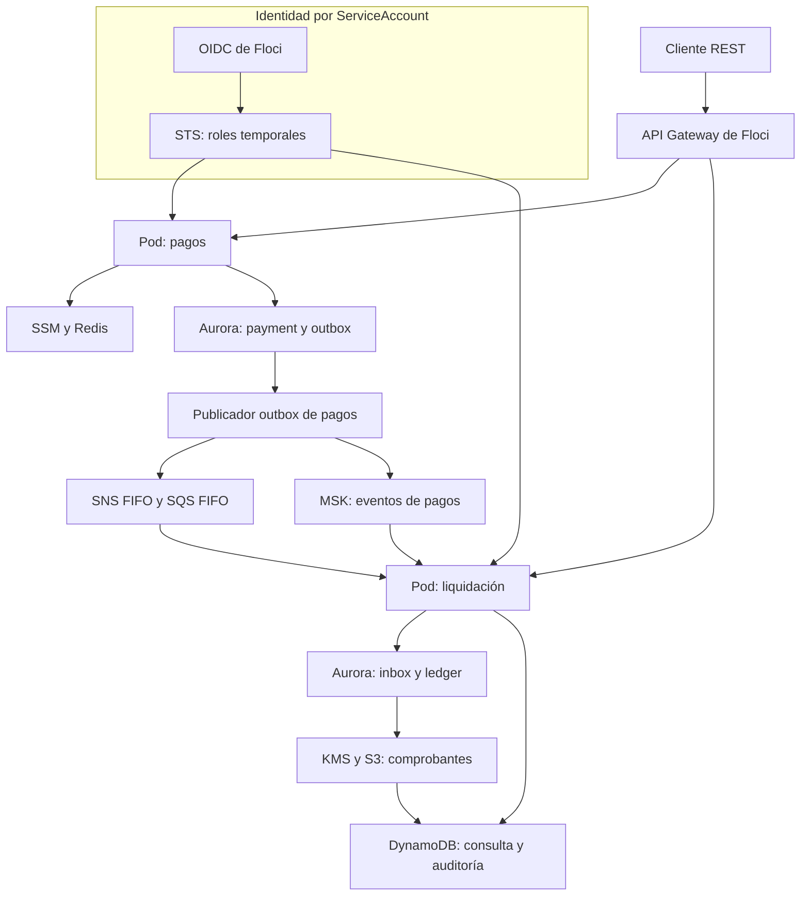

# Arquitectura de microservicios de pagos con Floci

Se implementa una plataforma local de pagos cuyo **caso de uso técnico es probar una arquitectura de microservicios sobre Floci**: se aprovisionan recursos mediante APIs AWS, se utilizan clientes AWS SDK reales y se separan las identidades de ejecución y los datos de cada contexto. Se prueban API Gateway, Aurora PostgreSQL, SNS/SQS, MSK, DynamoDB, S3, Secrets Manager, Parameter Store, ElastiCache Redis, EKS, IAM, STS, KMS y CloudWatch.

Se conservan **dos microservicios REST**: `payment-service` registra órdenes de pago y `settlement-service` procesa liquidación, comprobantes y auditoría. La separación permite comprobar comunicación asíncrona y permisos distintos sin añadir un servicio dedicado a simular fallos. `platform` es una biblioteca compartida; no se ejecuta ni despliega como servicio.

## Caso funcional

Se registra una orden tokenizada para un comercio y se consulta su límite operativo en Parameter Store, con caché Redis de 30 segundos. Se devuelve `ACCEPTED` cuando el monto cumple la política o `REJECTED` cuando supera el límite. Se utiliza `Idempotency-Key` para recuperar la misma operación sin generar eventos duplicados. El alcance financiero se limita al registro de órdenes y la contabilidad del laboratorio.

La decisión y dos entregas outbox se confirman en la misma transacción PostgreSQL. SNS/SQS transporta la orden hacia liquidación; MSK conserva el flujo para auditoría. En liquidación se registra inbox, se generan dos asientos balanceados para pagos aceptados y se prepara el comprobante. Los pagos rechazados reciben un comprobante sin asientos. Se firma el contenido con KMS, se publica en S3 y se actualiza la proyección de consulta en DynamoDB.

## Qué se demuestra con Floci

| Capacidad | Aplicación en la PoC | Comprobación |
|---|---|---|
| APIs AWS y descubrimiento | Se crean recursos con boto3; los servicios usan AWS SDK Java v2 | Se conservan ARN, endpoints y región descubiertos en `.runtime/` |
| API Gateway HTTP API | Se enrutan las cinco operaciones públicas de pagos y liquidación | Se comprueba proxy HTTP, parámetros de ruta y reenvío de `X-Api-Key` |
| Aurora PostgreSQL | Se crean un cluster, dos usuarios y dos esquemas | Se comprueban tokens IAM, TLS `verify-full` y aislamiento SQL |
| IAM, STS y OIDC | Se crea un rol por ServiceAccount con sujeto y audiencia exigidos | Se acepta el sujeto propio y se rechaza el de otro servicio |
| EKS | Se despliegan dos ServiceAccounts, Deployments y Services en k3s administrado por Floci | Se consultan pods y el rol efectivo desde `/internal/platform` |
| SNS/SQS FIFO | Se distribuyen eventos con grupo y deduplicación estables | Se confirma SQS después del commit; se dispone de DLQ tras cinco recepciones fallidas |
| MSK | Se publica Kafka con `acks=all` e idempotencia del productor | Se consulta una auditoría persistida por el consumidor con partición y offset |
| DynamoDB | Se materializan comprobantes y auditoría independiente | Se utiliza escritura condicional para impedir cambios del mismo evento |
| Secrets Manager y SSM | Se almacenan claves de API y políticas del comercio | Se recuperan con credenciales temporales del rol correspondiente |
| Redis administrado | Se crea un replication group ElastiCache de un nodo y se consulta su proxy | Se espera `available`; la política sigue disponible desde SSM cuando falla la caché |
| S3 y KMS | Se guardan comprobantes versionados y firmas RSA-PSS | Se verifica la firma de los bytes almacenados en S3 |
| CloudWatch | Se envían métricas y se aprovisiona una alarma de volumen | Se consulta la configuración y se prueban permisos de publicación |
| VPC y subnets | Se crean los recursos de red requeridos por las APIs EKS/MSK | Se reutilizan identificadores reales del plano de control emulado |

Se mantienen únicamente recursos asociados al flujo. Aurora cubre el almacenamiento relacional; se evita crear una instancia RDS adicional. El flujo de auditoría se implementa con MSK y no necesita otro bus ni una cola sin consumidor.

## Arquitectura



API Gateway y las APIs AWS se emulan dentro de Floci. Floci crea contenedores reales para PostgreSQL, Redis y Redpanda; en el modo EKS también crea k3s. No se declara otro PostgreSQL, Redis o Kafka en Compose porque se duplicaría la infraestructura administrada por el emulador. Secrets Manager y CloudWatch se consumen desde los dos servicios.

Se resuelve el broker MSK mediante las etiquetas Docker de servicio, recurso, cuenta y región en `axiz-network`. Se cruza la dirección devuelta por `GetBootstrapBrokers` con la inspección del contenedor y se conserva su nombre DNS, que Redpanda anuncia a los clientes Kafka. Se admiten nombres basados en identificadores de volumen, como `floci-msk-dfda92`, sin depender del nombre del clúster. Se rechaza la selección cuando el broker no existe, está detenido o resulta ambiguo.

## Tecnologías y versiones

| Tecnología | Versión | Uso |
|---|---|---|
| Java | 25; imagen Temurin `25.0.4.1_1` | Records, threads virtuales y compilación `release 25` |
| Spring Boot / Spring Framework | 4.1.1 / 7.0.9 | REST MVC, validación, configuración y ciclo de vida |
| Maven | 3.10.0 | Reactor y wrapper Linux con verificación SHA-512 |
| AWS SDK Java | 2.55.11 | Clientes AWS y credenciales de identidad web |
| Floci | 2.1.0 | Plano de control AWS y motores locales administrados |
| PostgreSQL / JDBC | 18.6 / 42.7.13 | Motor de Aurora emulado y conexiones IAM |
| Flyway | 12.4.0 | Migraciones por esquema durante bootstrap |
| Kafka client / Redpanda | 4.2.1 / 26.2.3 | Productor y consumidor del MSK emulado |
| Redis | 8.8.3 | Motor del ElastiCache emulado |
| k3s | 1.35.9-k3s1 | Kubernetes del EKS emulado |
| Jackson | 3.1.5 | JSON con la API `tools.jackson` de Spring Boot 4 |
| Spotless / Google Java Format | 3.0.0 / 1.33.0 | Formato Java comprobado durante `verify` |
| boto3 / psycopg | 1.43.108 / 3.3.6 | Aprovisionamiento y validación AWS/PostgreSQL |

Se heredan las versiones compatibles de Spring, Jackson, JDBC, Flyway y Kafka desde el BOM de Spring Boot. Se importan las versiones AWS desde su BOM. Se seleccionan clientes SDK directos para evitar introducir una integración Spring Cloud AWS sin compatibilidad comprobada con Spring Boot 4.1.

## Estructura del proyecto

| Carpeta o archivo | Contenido |
|---|---|
| `payment-service/` | Dominio de órdenes, casos de uso, REST, PostgreSQL, SSM/Redis y publicador SNS/Kafka |
| `settlement-service/` | Dominio contable, consumidores SQS/Kafka, ledger, comprobantes S3/KMS y proyecciones DynamoDB |
| `platform/` | Biblioteca de identidad web, datasource IAM, filtros HTTP, métricas y catálogo de rutas |
| `infrastructura/` | Compose, imágenes base, bootstrap AWS, despliegue EKS, pruebas AWS y ejemplos JSON |
| `datasets/` | Pagos de ejemplo y precarga idempotente mediante la API |
| `scripts/` | Construcción, ejecución host, descubrimiento DNS, pruebas y rutas |
| `validation/` | Registros y resultados de comprobaciones ejecutadas |
| `.env.example`, `application.yml.example` | Ejemplos de configuración y comentarios sobre los valores admitidos |
| `pom.xml`, `mvnw` | Reactor Maven importable en el IDE y lanzador Linux |

Se utiliza el paquete raíz `pe.axiz`. Se conserva la organización hexagonal de la plantilla: `domain`, `application/ports`, `application/service`, `adapters/in`, `adapters/out` y `configuration`. El dominio no depende de Spring ni de AWS.

## Código principal

`PaymentService` valida la orden, calcula una huella SHA-256, recupera replays y evalúa la política del comercio. `JdbcPaymentStore.record` inserta pago y outbox en una transacción; la restricción única protege carreras con la misma clave. Un replay idéntico no vuelve a consultar SSM. La reutilización de la clave con otro contenido devuelve HTTP 409.

`OutboxPublisher` reserva entregas con `FOR UPDATE SKIP LOCKED`, libera la transacción antes de usar la red y confirma cada destino por separado. Se aplica una reserva temporal de 60 segundos y un reintento persistido con espera hasta 60 segundos. Un fallo de SNS no marca Kafka como confirmado ni elimina la decisión.

`SettlementConsumer` procesa SQS con visibilidad de 30 segundos. `JdbcLedger` confirma inbox, asientos y outbox de comprobante en una única transacción. La confirmación SQS se realiza después del commit. Se preserva el mensaje ante un fallo para reintento o DLQ.

`PaymentAuditConsumer` consume MSK con auto commit deshabilitado. `DynamoAuditStore` registra el evento con `attribute_not_exists(pk)`; un replay conserva su primera posición y un cambio de contenido se rechaza. Se confirma el offset después de persistir. Un fallo reposiciona la partición sin confirmar el registro; un evento inválido bloquea esa partición hasta su corrección operativa.

`ReceiptPublisher` firma exactamente los bytes del evento y publica la clave determinista `receipts/{paymentId}.json` con metadatos de firma. La tabla de proyección se actualiza antes de confirmar el outbox de comprobante. S3 puede conservar nuevas versiones durante una recuperación.

`AwsConfiguration` usa `StsWebIdentityTokenFileCredentialsProvider` con renovación asíncrona. `IamDataSource` genera un token RDS al crear cada conexión física; Hikari conserva conexiones, no una contraseña IAM estática. Se verifica la CA y el hostname con TLS. `DatabaseConfiguration` configura el esquema en Hikari: se ejecuta `Connection.setSchema` después de autenticar la conexión y se restaura ese esquema si se modifica durante un préstamo. Esta selección permite atravesar el proxy de Floci, que no transmite las opciones del mensaje inicial PostgreSQL. `PlatformIdentityController` consulta la identidad AWS y ejecuta `DatabaseIdentity.inspect` sobre una única conexión JDBC. Se devuelven el usuario, el esquema, `sslMode` leído de los metadatos de esa conexión abierta y `backendTls` obtenido de `pg_stat_ssl`; no se publica la URL JDBC ni sus credenciales. El driver exige `verify-full` al abrir cada conexión. El indicador del backend se informa por separado porque Floci termina TLS en su proxy.

## Preparación en Fedora WSL

Se requiere JDK 25, Python 3, curl, Docker Engine con Compose 2.20 o superior y conectividad para descargar dependencias e imágenes. En WSL se habilita systemd y se utiliza un daemon Docker accesible desde la distribución. Se recomienda asignar 8 GB de memoria al laboratorio y más capacidad al modo EKS.

```bash
sudo dnf install java-25-openjdk-devel python3 curl
docker version
docker compose version
cp .env.example .env
chmod +x mvnw scripts/*.sh datasets/*.sh
mkdir -p .runtime
```

Se instala Docker según la [guía oficial para Fedora](https://docs.docker.com/engine/install/fedora/) si todavía no está disponible. Se ejecutan todos los comandos desde la raíz. La configuración se consulta en los archivos de ejemplo.

## Imágenes base reutilizables

Compose construye primero una imagen Java que contiene las herramientas de descarga, Maven y las dependencias del reactor. Sólo se copian el wrapper y los POM en esa etapa, por lo que los cambios de código no invalidan la descarga de dependencias. Se construyen después las imágenes de herramientas y de los dos servicios. Se puede preparar este conjunto por separado:

```bash
bash scripts/build-base.sh
```

La imagen de herramientas contiene boto3, psycopg, Docker CLI, socat y las migraciones. Las imágenes de aplicación compilan offline sobre la base y ejecutan JRE con usuario no root. El paso separado es opcional cuando se utiliza `up --build`. Las imágenes `axiz-*` se construyen localmente; su política `pull_policy: never` evita búsquedas en Docker Hub. `--no-build` permite reutilizarlas después de una construcción completa. En EKS se importan las imágenes directamente en containerd; se deshabilita ECR en Floci porque el flujo no publica ni descarga imágenes desde ese registro.

Se importa el `pom.xml` raíz en el IDE y se selecciona JDK 25. La compilación local se realiza con:

```bash
./mvnw -B -ntp verify
```

## Ejecución en EKS administrado por Floci

Se utiliza este modo para comprobar las conexiones a Aurora desde pods y ServiceAccounts. En la primera ejecución, después de la preparación del entorno, se construyen las imágenes y se inicia la infraestructura y el despliegue en primer plano con un solo comando:

```bash
docker compose -f infrastructura/compose.yml -f infrastructura/compose.eks.yml --profile eks up --build
```

Se pueden reutilizar las imágenes existentes:

```bash
docker compose -f infrastructura/compose.yml -f infrastructura/compose.eks.yml --profile eks up --no-build
```

El bootstrap crea recursos AWS, CA, roles, esquemas y migraciones. Las tareas `payment-image` y `settlement-image` construyen las imágenes de aplicación y terminan sin iniciar JVM ni publicar puertos; el despliegue espera su finalización y la del bootstrap. `eks.py` comprueba la API Kubernetes y containerd, importa las imágenes locales en el namespace `k8s.io`, verifica sus referencias, aplica ServiceAccounts, Deployments y Services, espera readiness, precarga pagos y muestra las rutas. Se conserva el manifiesto aplicado en `.runtime/deployment.local.yml`. Se incluyen huellas de imagen y configuración en el pod para provocar un rollout al actualizar el código o la CA. Se utiliza nuevamente `up --build` para aplicar cambios de código o de la imagen base.

Los NodePorts pertenecen al contenedor k3s; Floci sólo publica directamente su API Kubernetes. El servicio Compose `eks-access` espera el despliegue y publica `127.0.0.1:30080` y `127.0.0.1:30081` mediante socat hacia los NodePorts en `axiz-network`. Se utiliza la misma imagen de herramientas, sin montar credenciales ni el socket Docker, con usuario sin privilegios y filesystem de sólo lectura. Se conserva el transporte TCP y se resuelve el nombre del nodo en cada conexión. Este acceso local permite ejecutar curl desde Fedora WSL, también con Docker Desktop; no representa un componente de AWS EKS. Las comprobaciones de salud del puente se ejecutan sin imprimir solicitudes periódicas en sus logs.

Se espera el estado `healthy` de `eks-access` antes de probar el flujo desde otra terminal:

```bash
docker compose -f infrastructura/compose.yml -f infrastructura/compose.eks.yml --profile eks ps eks-access
PAYMENT_URL=http://localhost:30080 SETTLEMENT_URL=http://localhost:30081 bash scripts/smoke.sh
```

Se utilizan `axiz-payment` y `axiz-settlement` en el namespace `axiz`. Cada trust policy exige `system:serviceaccount:axiz:<service-account>` y audiencia `sts.amazonaws.com`. Se limita `rds-db:connect` al recurso del cluster y al usuario de cada contexto. Las aplicaciones no reciben claves AWS permanentes ni la contraseña de administración SQL.

**Particularidad de Floci:** se obtiene el JWT firmado del endpoint OIDC local del emulador mediante un init container y un renovador. Se utilizan el ServiceAccount y namespace efectivos del pod mediante Downward API y un volumen en memoria. Este emisor local no atesta la identidad de un pod AWS real. La adaptación a AWS EKS utiliza tokens proyectados de Kubernetes; se incluye `infrastructura/kubernetes/aws-irsa-patch.yml` como base de esa adaptación. Se requieren ARN, endpoints, CA e imágenes publicados en el entorno AWS real.

```bash
docker exec floci-eks-axiz-payments /bin/kubectl --kubeconfig /etc/rancher/k3s/k3s.yaml -n axiz get pods
docker exec floci-eks-axiz-payments /bin/kubectl --kubeconfig /etc/rancher/k3s/k3s.yaml -n axiz logs deployment/axiz-payment -c payment
```

## Ejecución completa con Compose

Se inicia infraestructura, aplicaciones, migraciones, renovación de identidad, precarga y rutas en un solo comando:

```bash
docker compose -f infrastructura/compose.yml --profile full up --build
```

Se reutilizan las imágenes sin compilación con:

```bash
docker compose -f infrastructura/compose.yml --profile full up --no-build
```

En esta modalidad EKS mantiene metadatos y emisión OIDC para el laboratorio; no se crean pods. Los servicios se ejecutan en Compose con roles temporales. El archivo del modo EKS activa el motor Kubernetes real.

## Infraestructura en Compose y aplicaciones en host

Se mantiene la infraestructura en primer plano en una terminal:

```bash
docker compose -f infrastructura/compose.yml -f infrastructura/compose.host.yml up --build
```

Después del mensaje de aprovisionamiento completado, se utiliza otra terminal para registrar el broker anunciado e iniciar los dos servicios:

```bash
sudo bash scripts/host-dns.sh
bash scripts/run-host.sh
```

`run-host.sh` compila, inicia las JVM, precarga pagos, muestra rutas y finaliza ambos procesos al recibir una interrupción. Se mantiene el renovador de identidad de Compose en ejecución. Si se reutilizan imágenes de infraestructura se sustituye `--build` por `--no-build`.

## Migraciones y precarga

Flyway mantiene una historia independiente por esquema. El bootstrap crea usuarios y esquemas y ejecuta las migraciones como propietario. Se invoca el plugin mediante `org.flywaydb:flyway-maven-plugin:migrate`; su versión se obtiene del POM y se utiliza `-o` para resolver las dependencias ya preparadas en la imagen base. Se evita consultar feeds de terceros durante el arranque. Los usuarios de aplicación reciben DML y uso de secuencias; se revoca el acceso a la historia Flyway y no se habilita creación de tablas. `datasets` no repite DDL ni migraciones.

Se precargan tres órdenes aceptadas del comercio `merchant-demo`, con claves de idempotencia estables. Se conserva el resultado en `.runtime/dataset-results.json`. Se puede repetir la precarga desde la raíz:

```bash
bash datasets/seed.sh
```

En EKS se utiliza:

```bash
bash datasets/seed.sh http://localhost:30080
```

Se utiliza un volumen `floci-data-v2` para este modelo. Al sustituir una versión anterior se detiene primero su stack y se utiliza un despliegue nuevo; no se aplica este esquema inicial sobre la historia Flyway anterior.

## Endpoints en orden del flujo

| Método y ruta | Servicio | Función | Descripción técnica |
|---|---|---|---|
| `GET /actuator/health/readiness` | Ambos | Comprobar arranque | Actuator, sin detalles internos |
| `GET /internal/platform` | Ambos | Comprobar rol y conexión a Aurora | STS, `current_user`, esquema, modo TLS del cliente y TLS del backend; `X-Internal-Key` |
| `POST /api/payments` | Pagos | Registrar una orden | `X-Api-Key`, `Idempotency-Key`; decisión y outbox atómicos; HTTP 200 |
| `GET /api/payments/{id}` | Pagos | Consultar la orden | Lectura PostgreSQL; `X-Api-Key` |
| `GET /api/settlements/{id}` | Liquidación | Consultar comprobante | Lectura consistente DynamoDB; 404 mientras se materializa |
| `GET /api/settlements/{id}/ledger` | Liquidación | Consultar asientos | Lectura del esquema propio; array vacío para rechazo |
| `GET /api/settlements/{id}/audit` | Liquidación | Consultar auditoría MSK | DynamoDB con payload original, partición y offset |
| `GET /internal/outbox` | Pagos | Revisar entregas SNS/Kafka | Totales y pendientes por destino; `X-Internal-Key` |
| `GET /internal/settlement/backlog` | Liquidación | Revisar pendientes | Conteos inbox y comprobantes; `X-Internal-Key` |
| `GET /actuator/health/liveness` | Ambos | Comprobar vida del proceso | Sonda independiente del negocio |
| `GET /actuator/metrics` | Ambos | Consultar métricas | Micrometer; se consulta una métrica en `/actuator/metrics/{nombre}` |
| `GET /actuator/prometheus` | Ambos | Exportar métricas | Texto Prometheus, sin desplegar otro servidor |
| `GET /actuator/info` | Ambos | Consultar metadatos Actuator | HTTP 200; objeto vacío si no hay contribuciones configuradas |
| `GET /routes` | Ambos | Listar rutas al terminar el arranque | Catálogo de mappings REST |
| `/error` | Ambos | Gestionar errores HTTP | Handler automático de Spring Boot; mappings HTML y general |

Las rutas `/api/settlements/**` requieren `X-Api-Key`. Los puertos host/Compose son 8080 y 8081; los NodePorts EKS se publican en localhost mediante `eks-access` en 30080 y 30081. API Gateway publica las cinco rutas `/api/**` de la tabla. Se utilizan `X-Api-Key` y `X-Internal-Key` cargadas desde Secrets Manager al inicio; su rotación requiere reiniciar los servicios. Se propaga `X-Correlation-Id` o se genera un UUID cuando falta.

## Pruebas por curl

Se preparan las rutas para host/Compose y se cargan las claves generadas:

```bash
payment=http://localhost:8080
settlement=http://localhost:8081
api_key=$(cat .runtime/api-key)
internal_key=$(cat .runtime/internal-key)
key="curl-$(date +%s%N)"
```

En EKS se seleccionan las rutas locales publicadas por `eks-access`:

```bash
payment=http://localhost:30080
settlement=http://localhost:30081
```

### Identidad efectiva y conexión SQL

Se consulta STS con el rol del servicio y se comprueba la sesión PostgreSQL. El request no tiene body:

```bash
curl -fsS "$payment/internal/platform" -H "X-Internal-Key: $internal_key"
```

Se devuelve una respuesta equivalente a:

```json
{"awsRole":"arn:aws:sts::000000000000:assumed-role/axiz-payment/payment-service","account":"000000000000","database":{"username":"axiz_payment","schema":"payment","sslMode":"verify-full","backendTls":false}}
```

`sslMode: verify-full` corresponde al modo del driver de la conexión abierta: se exige cifrado y se validan la CA y el hostname durante el login. `backendTls` corresponde al tramo visto por PostgreSQL. En Floci se espera `false` porque el proxy termina TLS antes de conectarse al motor local. Se verifica el tramo cliente desde libpq mediante `connection.pgconn.ssl_in_use` en `verify_aws.py`, manteniendo `verify-full`, y se selecciona el esquema después del login IAM. Se conserva el aislamiento SQL entre servicios.

### Registro e idempotencia

Se registra una orden conforme al límite del comercio:

```bash
result=$(curl -fsS -X POST "$payment/api/payments" \
  -H "X-Api-Key: $api_key" -H "Idempotency-Key: $key" \
  -H 'Content-Type: application/json' -d @infrastructura/requests/payment.json)
printf '%s\n' "$result"
id=$(printf '%s' "$result" | python3 -c 'import json,sys; print(json.load(sys.stdin)["id"])')
```

El request contiene `merchantId`, `amount`, `currency` y `token`. Se devuelve HTTP 200:

```json
{"id":"cb5f377e-80db-4d35-aea6-c0acbe7e2d2e","merchantId":"merchant-demo","amount":25.50,"currency":"PEN","status":"ACCEPTED","reason":"POLICY_ACCEPTED"}
```

Se repite exactamente el request para obtener el mismo identificador y conservar una sola decisión y dos entregas outbox:

```bash
curl -fsS -X POST "$payment/api/payments" \
  -H "X-Api-Key: $api_key" -H "Idempotency-Key: $key" \
  -H 'Content-Type: application/json' -d @infrastructura/requests/payment.json
```

Se modifica el monto manteniendo la clave para comprobar HTTP 409:

```bash
curl -sS -i -X POST "$payment/api/payments" \
  -H "X-Api-Key: $api_key" -H "Idempotency-Key: $key" \
  -H 'Content-Type: application/json' \
  -d '{"merchantId":"merchant-demo","amount":26.00,"currency":"PEN","token":"tok_demo"}'
```

Se devuelve un ProblemDetail con `status: 409` y detalle de reutilización de la clave. Un campo inválido produce 400; una indisponibilidad AWS/SQL durante el registro produce 503 y no se confirma una orden incompleta.

### Acceso a través de API Gateway

Se utiliza el host virtual de Floci para seleccionar la API. El request GET no tiene body y devuelve la misma orden:

```bash
curl -fsS "http://localhost:4566/api/payments/$id" \
  -H 'Host: axiz-payments.execute-api.localhost.floci.io' -H "X-Api-Key: $api_key"
```

### Liquidación, comprobante y auditoría

Se consulta la proyección después del procesamiento asíncrono. El request GET no tiene body; mientras se procesa se puede recibir 404:

```bash
curl -fsS "$settlement/api/settlements/$id" -H "X-Api-Key: $api_key"
curl -fsS "$settlement/api/settlements/$id/ledger" -H "X-Api-Key: $api_key"
curl -fsS "$settlement/api/settlements/$id/audit" -H "X-Api-Key: $api_key"
```

La proyección devuelve `pk`, `status`, `amount`, `currency` y `receiptKey`. El ledger devuelve dos entradas `PAYMENT_CLEARING` y `MERCHANT_PAYABLE`, con importes 25.50 y -25.50 y suma cero. La auditoría devuelve `eventId`, `payload`, `partition` y `offset`; se conserva el contenido original publicado en MSK.

### Rechazo por política

Se registra un importe superior al límite inicial 5000.00 mediante una clave nueva:

```bash
curl -fsS -X POST "$payment/api/payments" \
  -H "X-Api-Key: $api_key" -H "Idempotency-Key: rejected-$key" \
  -H 'Content-Type: application/json' -d @infrastructura/requests/payment-rejected.json
```

Se devuelve HTTP 200 con `status: REJECTED` y `reason: MERCHANT_LIMIT_EXCEEDED`. Se generan comprobante y auditoría; la consulta de ledger devuelve `[]`.

### Pendientes y autenticación

Se inspecciona el procesamiento sin modificar datos. Los requests GET no tienen body:

```bash
curl -fsS "$payment/internal/outbox" -H "X-Internal-Key: $internal_key"
curl -fsS "$settlement/internal/settlement/backlog" -H "X-Internal-Key: $internal_key"
curl -sS -i "$payment/internal/platform"
curl -sS -i "$payment/api/payments/$id"
```

Se devuelven conteos de pendientes en las dos primeras operaciones y HTTP 401 en las consultas sin clave. El outbox devuelve destinos `SNS` y `KAFKA`, `total` y `pending`; el backlog devuelve `pendingReceipts` e `inbox`.

## Conjunto completo de pruebas

Con infraestructura y aplicaciones levantadas se ejecuta todo desde la raíz:

```bash
bash scripts/test.sh all
```

Se incluyen compilación, formato Java, pruebas de dominio y diagnóstico TLS, pruebas PostgreSQL con Testcontainers, pruebas AWS SDK contra Floci, recuperación del aprovisionador, sintaxis Python/shell, smoke REST, API Gateway y verificaciones de identidad IAM, TLS, aislamiento SQL y firmas KMS en S3. Se ejecutan sin tráfico concurrente ajeno al laboratorio y con la política inicial del dataset. La prueba SNS publica un evento técnico rechazado, sin asientos contables.

Para EKS se utilizan las rutas locales publicadas por `eks-access`:

```bash
PAYMENT_URL=http://localhost:30080 SETTLEMENT_URL=http://localhost:30081 bash scripts/test.sh all
```

Se puede ejecutar sólo compilación y pruebas sin infraestructura:

```bash
bash scripts/test.sh
```

La suite AWS SDK se activa con `RUN_FLOCI_IT=true` y la PostgreSQL con `RUN_POSTGRES_IT=true`; el modo `all` activa ambas. La verificación AWS se ejecuta en la imagen de herramientas y no requiere instalar AWS CLI. Se pueden repetir únicamente las comprobaciones de roles, Aurora y firmas:

```bash
docker compose -f infrastructura/compose.yml run --rm --no-deps bootstrap python3 infrastructura/verify_aws.py
```

Se comprueba la recuperación de creaciones lentas y respuestas perdidas con el SDK boto3 real contra un servidor HTTP local de prueba. Se verifica una sola solicitud de creación, la reconciliación posterior por lectura, la espera limitada y el rechazo inmediato de errores de permisos. Estas pruebas se ejecutan al construir la imagen de herramientas y durante `scripts/test.sh all`. Se pueden repetir sin iniciar Floci:

```bash
docker compose -f infrastructura/compose.yml run --rm --no-deps bootstrap python3 -m unittest discover -s infrastructura/tests -v
```

## Evidencia y límites de la emulación

Se conserva en `validation/` evidencia opcional de las comprobaciones; esa carpeta no se consume durante el arranque y puede eliminarse. La compilación actual utiliza JDK 25.0.4.1 y Maven 3.10.0 y termina con `BUILD SUCCESS`. Se aprueban **30 pruebas Java: 19 de dominio, 3 de configuración de conexiones y 8 de diagnóstico TLS**, además de Spotless. Se omiten las ocho pruebas AWS y las cuatro PostgreSQL que necesitan infraestructura activa. Se conserva `validation/tls-diagnostics-maven.log`.

Las pruebas de configuración utilizan Hikari real y un driver simulado que comienza en `public`; se comprueban esquemas distintos y su restauración después de devolver una conexión. Las de diagnóstico utilizan el parser real de pgJDBC y metadatos de conexión simulados: se separan `sslMode` y `backendTls`, se conservan los modos menos estrictos para detectarlos y se rechaza un driver desconocido. No se establece una conexión física a Aurora en esas pruebas.

Se aprueban **49 pruebas de infraestructura**, incluidas recuperación de creaciones con boto3 contra un servidor HTTP local, grupos ElastiCache, descubrimiento y recuperación MSK, importación de imágenes EKS, cuatro pruebas del puente con socat real y siete de identidad y diagnóstico TLS. Las operaciones Docker y las conexiones SQL de los verificadores se simulan; el puente se comprueba con dos backends HTTP reales. Se verifica concurrencia, cabeceras, contenido binario y cierre de listeners. Se conservan los resultados actuales en `validation/tls-diagnostics-infrastructure.log`. Se aprueban también Ruff, ShellCheck, compilación Python y las configuraciones EKS, completa y host mediante Compose 5.6.0.

Se ejecuta el script smoke real contra backends HTTP de prueba: termina con `verify-full` y `backendTls: false`, espera cuatro respuestas 404 transitorias y rechaza `prefer` con un diagnóstico explícito. Se conserva `validation/tls-diagnostics-smoke-contract.log`. Esta comprobación valida el script y sus códigos de salida; las respuestas del negocio y de API Gateway se simulan y no representan una prueba adicional de AWS.

Se conservan comprobaciones anteriores con el binario oficial Floci 2.1.0: ocho pruebas del SDK Java, contratos SNS/SQS, S3, KMS, API Gateway, Redis y persistencia MSK. Se utilizaron backends HTTP o motores en modo mock; no se arrancaron pods ni motores físicos de PostgreSQL, Redis o MSK. Se conserva también una comprobación de las herramientas reales de la imagen k3s y de la resolución offline del plugin Flyway.

La ejecución compartida de Fedora WSL del 8 de octubre de 2026 confirma el aprovisionamiento, ambas migraciones, el rollout de los dos servicios, la precarga y el acceso desde los puertos EKS publicados. La salida de smoke confirma registro, replay, conflicto de idempotencia, rechazo persistido, SNS/SQS, liquidación, auditoría MSK y balance contable. Los 404 se resuelven durante la espera de las proyecciones; el fallo posterior corresponde a la comprobación anterior de TLS, que medía el backend del proxy. Se corrige esa comprobación manteniendo `verify-full`. **Queda pendiente repetir el smoke con la versión actual contra el EKS de ejecución y ejecutar las cuatro pruebas PostgreSQL; el entorno de generación no dispone de daemon Docker.**

Se combinan entrega al menos una vez, outbox, inbox e identificadores estables. Una caída entre publicación y confirmación puede repetir un evento Kafka; la auditoría lo deduplica por `eventId`. SNS FIFO limita la deduplicación a su ventana temporal. S3 conserva versiones repetidas del mismo comprobante. No se promete una transacción distribuida ni entrega exactamente una vez entre sistemas.

Floci no reproduce la red VPC ni la durabilidad/alta disponibilidad de AWS. Se utiliza Kafka PLAINTEXT y Redis sin autenticación dentro de la red local. PostgreSQL 18.6 se ejecuta como motor de Aurora emulado; esta selección no implica que AWS Aurora publique la misma versión. MSK utiliza el motor Redpanda administrado por Floci y no prueba la autenticación IAM de brokers AWS.

Se conservan políticas con recursos concretos y tres concesiones locales necesarias en Floci 2.1.0: `monitoring:PutMetricData` por el prefijo de su protocolo CloudWatch, `sns:Publish` sobre los topics de la cuenta/región por su resolución JSON y `kms:Sign` sobre las claves de la cuenta/región porque el emulador evalúa `key/*`. Estas concesiones permiten probar los clientes reales, pero limitan la granularidad demostrable de SNS/KMS. Se retiran al adaptar las políticas a AWS; se conserva entonces únicamente el topic y la clave concreta. La denegación entre roles para DynamoDB/SSM y el sujeto OIDC se verifica mediante pruebas.

## Operación

Se muestran las rutas al final del arranque o mediante:

```bash
bash scripts/routes.sh
```

En EKS se utiliza:

```bash
PAYMENT_URL=http://localhost:30080 SETTLEMENT_URL=http://localhost:30081 bash scripts/routes.sh
```

No se habilita access logging de sondas HTTP ni se imprime el health check de forma continua. Los logs operativos se consultan cuando se necesita diagnosticar un fallo:

```bash
docker compose -f infrastructura/compose.yml logs bootstrap
docker compose -f infrastructura/compose.yml logs payment settlement
```

Ante un error TLS se comprueban CA, volumen de Floci y hostname del datasource; se mantiene `verify-full`. Si no resuelve Kafka en el host se reaplica `sudo bash scripts/host-dns.sh` y se comprueba que `/etc/hosts` no conserve una IP anterior. En EKS se reaplica el despliegue para actualizar `hostAliases`.

Un mensaje aislado `the database system is starting up` puede producirse cuando el emulador intenta conectarse mientras PostgreSQL todavía se inicia. Se comprueba que después se validen las migraciones y termine el bootstrap con código 0. Si el mensaje persiste o falla la espera de disponibilidad, se inspecciona el motor antes de continuar. Las entradas `/error` impresas al final son rutas del manejador de errores de Spring Boot; forman parte del catálogo de endpoints. La salida con código 0 de las tareas de construcción, bootstrap y despliegue indica que se completaron esas tareas.

Si curl devuelve `Failed to connect to localhost port 30080` o `30081` después de completar el rollout, se comprueba `eks-access` con el comando `ps` del modo EKS. Los NodePorts no se publicaban en el host en versiones anteriores. Se actualizan `compose.eks.yml`, `Dockerfile.tools` y `eks-access.sh` y se repite `up --build` con los dos archivos Compose. Se conservan `.env`, `.runtime/` y los volúmenes. Se consultan los logs del puente y la disponibilidad de ambos servicios:

```bash
docker compose -f infrastructura/compose.yml -f infrastructura/compose.eks.yml --profile eks logs eks-access
curl -fsS http://localhost:30080/actuator/health/readiness
curl -fsS http://localhost:30081/actuator/health/readiness
```

Si el smoke anterior termina al exigir `database.tls is True`, se actualizan el módulo `platform`, `smoke.sh`, `check_identity.py` y `verify_aws.py`, y se reconstruye con `up --build`. El campo ambiguo `tls` se sustituye por `sslMode` y `backendTls`. Se comprueba el endpoint interno con la clave generada; `sslMode` debe ser `verify-full`, y `backendTls: false` es compatible con la terminación TLS de Floci. Se conserva la CA y no se debilita el modo SSL. El mensaje de arranque de Floci `TLS: disabled (HTTP only)` describe su API HTTP; el proxy RDS utiliza su configuración TLS independiente.

Las advertencias Maven 401 de `flyway-community-db-support` y `MavenFeed` proceden de consultas de metadatos a feeds de terceros; no representan un rechazo de las credenciales IAM. El bootstrap utiliza el plugin Flyway del POM en modo offline para evitarlas. Si faltan artefactos en una imagen anterior, se reconstruye con `up --build` para preparar nuevamente su caché.

Los mensajes de purga o generación automática de un secreto HTTP de `registry:2` pertenecen al motor ECR de Floci. Este registro se mantiene deshabilitado porque el despliegue usa imágenes locales. Los contenedores o volúmenes retenidos de ejecuciones anteriores se conservan; no se aplica una limpieza global para eliminar esos mensajes. Al restaurar un motor, su stream de logs puede incluir entradas anteriores a la ejecución actual; se compara la fecha interna del mensaje con la hora del nuevo arranque.

Ante un rechazo STS se comprueban el renovador, audiencia, sujeto y rol. Si una proyección todavía no existe se inspeccionan outbox, backlog y consumidores antes de repetir el registro. Se mantienen las claves de idempotencia para recuperar operaciones existentes.

Si Flyway confirma las migraciones y los logs muestran `relation "payments" does not exist`, `relation "outbox" does not exist` o `relation "receipt_outbox" does not exist`, se comprueba el esquema desde `/internal/platform` con la clave interna. Floci 2.1.0 no transmite `currentSchema` del mensaje inicial del driver; se utiliza la selección de esquema de Hikari después de autenticar. Se actualiza `DatabaseConfiguration` y se reconstruyen las aplicaciones con `up --build`. Se conservan `.env`, `.runtime/` y los volúmenes; no se repiten ni modifican las migraciones para resolver este fallo.

Si `eks-deploy` termina con `No help topic for 'ctr'`, se actualiza `eks.py` y se reconstruye la imagen de herramientas con `up --build`. En la imagen k3s seleccionada se utilizan directamente `/bin/ctr` y `/bin/kubectl`, en lugar de sus invocaciones como subcomandos de `k3s`. Se especifican el socket `/run/k3s/containerd/containerd.sock`, el namespace `k8s.io` y el kubeconfig `/etc/rancher/k3s/k3s.yaml`. Se importa mediante el modo local de containerd y se comprueba la referencia antes de aplicar los pods con `imagePullPolicy: Never`.

Si una versión anterior termina con código 127 al ejecutar `mvnw` en `Dockerfile.base`, se actualizan el Dockerfile y el wrapper y se repite `up --build`: se instalan las herramientas de descarga antes de preparar Maven. Un mensaje `pull access denied` para `axiz-tools` indica que se está utilizando la configuración anterior; se actualizan los archivos Compose con la política de imágenes locales. Se conservan `.env`, `.runtime/` y los volúmenes al reemplazar los archivos del proyecto.

Durante la primera ejecución, Floci descarga y arranca los motores dentro de solicitudes del plano de control. Un timeout corto seguido de un reintento puede duplicar `CreateCluster` o `CreateDBCluster` mientras la primera solicitud sigue activa. Se mantiene un timeout amplio y se desactivan las repeticiones automáticas del SDK del aprovisionador. Ante una respuesta perdida o un recurso ya existente, `ensure` consulta su estado sin reenviar la creación; `wait` limita la espera y propaga los errores de permisos. Se recuperan los metadatos actuales de Aurora después de alcanzar `available`.

Redis se aprovisiona con `CreateReplicationGroup` y se descubre con `DescribeReplicationGroups`. Se utiliza un nodo primario, sin réplicas ni failover, para comprobar la caché con un solo motor. En Floci 2.1.0, `CreateCacheCluster` se reserva para Memcached; una solicitud con `Engine=redis` devuelve `InvalidParameterValue`. Se conserva la reconciliación por lectura si el grupo ya existe o se pierde la respuesta.

Floci 2.1.0 elimina el contenedor MSK durante su cierre y conserva los metadatos y el volumen, pero no restaura ese motor al reiniciar. El aprovisionador compensa esta limitación local: se inicia el contenedor detenido o se recrea exclusivamente el contenedor eliminado usando su volumen retenido y la imagen Redpanda configurada en Floci. Se verifica la identidad de cuenta, región, recurso y volumen, y se espera `/v1/status/ready`. Si el volumen no existe, se aborta la recuperación para evitar un Kafka vacío. Se conserva el ARN y se lee el estado del emulador desde el montaje de sólo lectura; no se elimina ni se vuelve a crear el recurso AWS.

Si MSK conserva un contenedor detenido después de eliminar y recrear `axiz-network`, se comparan el ID de la red conectada y `HostConfig.NetworkMode` con la red vigente. La búsqueda inicial utiliza las etiquetas del recurso, cuenta y región para localizar también contenedores asociados a una red eliminada. Ante una identidad de red anterior, se valida primero el volumen original y la configuración de Floci; se retira únicamente ese contenedor detenido mediante su ID, sin forzar su eliminación ni eliminar volúmenes, y se recrea en la red vigente. Si el contenedor se inicia durante esta operación, Docker rechaza su retirada y se conserva para diagnóstico. Se actualizan los archivos del proyecto y se repite el comando EKS con `--build`, conservando `.env`, `.runtime/` y los volúmenes.

Si `docker start` falla por otro motivo, se informa el texto devuelto por el daemon y se conserva el contenedor. Se consultan su estado, configuración de red y logs antes de continuar:

```bash
docker inspect floci-msk-dfda92 --format '{{json .State}}'
docker inspect floci-msk-dfda92 --format '{{json .NetworkSettings.Networks}}'
docker network inspect axiz-network --format '{{.Id}}'
docker logs --tail 100 floci-msk-dfda92
```

Se sustituye `floci-msk-dfda92` por el nombre concreto informado durante la recuperación.

Tras recuperar el motor, el endpoint del plano de control puede conservar una IP anterior. Se utiliza el nombre DNS del contenedor verificado para las aplicaciones y los `hostAliases` EKS. Se repite `up --build` después de actualizar los archivos del proyecto, conservando `.env`, `.runtime/` y los volúmenes. La recuperación pertenece al laboratorio Floci; no se utiliza esta operación Docker contra AWS MSK. El contenedor recuperado puede permanecer activo después de detener Compose y sus logs se consultan directamente con `docker logs <nombre-del-broker>`; no se reconecta automáticamente su stream interno de logs a CloudWatch.

Si una ejecución anterior termina con `DBClusterAlreadyExistsFault` o un conflicto de nombre de k3s, se actualizan los archivos del proyecto y se repite el comando EKS con `--build`. Se reconstruye la imagen de herramientas con el aprovisionador corregido y se reutilizan los recursos existentes. Se conserva el cluster EKS si ya se encuentra en `ACTIVE`; un estado `FAILED` requiere revisar los logs del motor antes de continuar.

Se interrumpen procesos de primer plano con Ctrl+C y se detiene Compose:

```bash
docker compose -f infrastructura/compose.yml --profile full --profile eks down
```

Para detener el modo EKS se incluyen ambos archivos, de modo que se retire también el puente de acceso:

```bash
docker compose -f infrastructura/compose.yml -f infrastructura/compose.eks.yml --profile eks down
```

Los motores auxiliares se crean desde Floci y pueden permanecer fuera del conjunto de servicios de Compose. No se elimina globalmente ningún contenedor ni volumen desde los scripts.

## Referencias técnicas

- [Floci 2.1.0](https://github.com/floci-io/floci/tree/2.1.0).
- [Aurora/RDS emulados](https://github.com/floci-io/floci/blob/2.1.0/docs/services/rds.md).
- [Terminación TLS en el proxy RDS de Floci](https://floci.io/floci/services/rds/#tls-ssl).
- [SSL y verificación de hostname en pgJDBC](https://jdbc.postgresql.org/documentation/ssl/).
- [Alcance de pg_stat_ssl](https://www.postgresql.org/docs/18/monitoring-stats.html#MONITORING-PG-STAT-SSL-VIEW).
- [TLS del cliente libpq](https://www.postgresql.org/docs/18/libpq-status.html#LIBPQ-PQSSLINUSE).
- [Protocolo del proxy PostgreSQL de Floci 2.1.0](https://github.com/floci-io/floci/blob/2.1.0/src/main/java/io/github/hectorvent/floci/services/rds/proxy/PostgresProtocolHandler.java).
- [EKS y emisión OIDC](https://github.com/floci-io/floci/blob/2.1.0/docs/services/eks.md).
- [Publicación de la API Kubernetes en Floci](https://github.com/floci-io/floci/blob/2.1.0/src/main/java/io/github/hectorvent/floci/services/eks/EksClusterManager.java).
- [Transporte TCP con socat](https://www.dest-unreach.org/socat/doc/socat.html).
- [Importación de imágenes en k3s](https://docs.k3s.io/add-ons/import-images).
- [Configuración del registro ECR en Floci](https://github.com/floci-io/floci/blob/2.1.0/docs/configuration/environment-variables.md).
- [Resolución de prefijos de plugins Maven](https://maven.apache.org/guides/introduction/introduction-to-plugin-prefix-mapping.html).
- [MSK emulado](https://github.com/floci-io/floci/blob/2.1.0/docs/services/msk.md).
- [Ciclo de vida y persistencia MSK en Floci 2.1.0](https://github.com/floci-io/floci/blob/2.1.0/src/main/java/io/github/hectorvent/floci/services/msk/MskService.java).
- [Arranque y almacenamiento Redpanda en Floci 2.1.0](https://github.com/floci-io/floci/blob/2.1.0/src/main/java/io/github/hectorvent/floci/services/msk/RedpandaManager.java).
- [Inspección de redes Docker](https://docs.docker.com/reference/cli/docker/network/inspect/).
- [Eliminación de contenedores y conservación de volúmenes](https://docs.docker.com/reference/cli/docker/container/rm/).
- [ElastiCache emulado](https://github.com/floci-io/floci/blob/2.1.0/docs/services/elasticache.md).
- [Grupos de replicación Redis/Valkey](https://docs.aws.amazon.com/AmazonElastiCache/latest/APIReference/API_CreateReplicationGroup.html).
- [Resolución de recursos IAM de Floci](https://github.com/floci-io/floci/blob/2.1.0/src/main/java/io/github/hectorvent/floci/services/iam/ResourceArnBuilder.java).
- [Requisitos de Spring Boot](https://docs.spring.io/spring-boot/system-requirements.html).
- [Construcción de imágenes y dependencias en Compose](https://docs.docker.com/reference/compose-file/build/).
- [Política de descarga de imágenes locales en Compose](https://docs.docker.com/reference/compose-file/services/#pull_policy).
- [Timeouts e intentos totales de botocore](https://docs.aws.amazon.com/botocore/latest/reference/config.html).
- [Autenticación IAM de Aurora](https://docs.aws.amazon.com/AmazonRDS/latest/AuroraUserGuide/UsingWithRDS.IAMDBAuth.html).
- [Roles por ServiceAccount en EKS](https://docs.aws.amazon.com/eks/latest/userguide/iam-roles-for-service-accounts.html).
