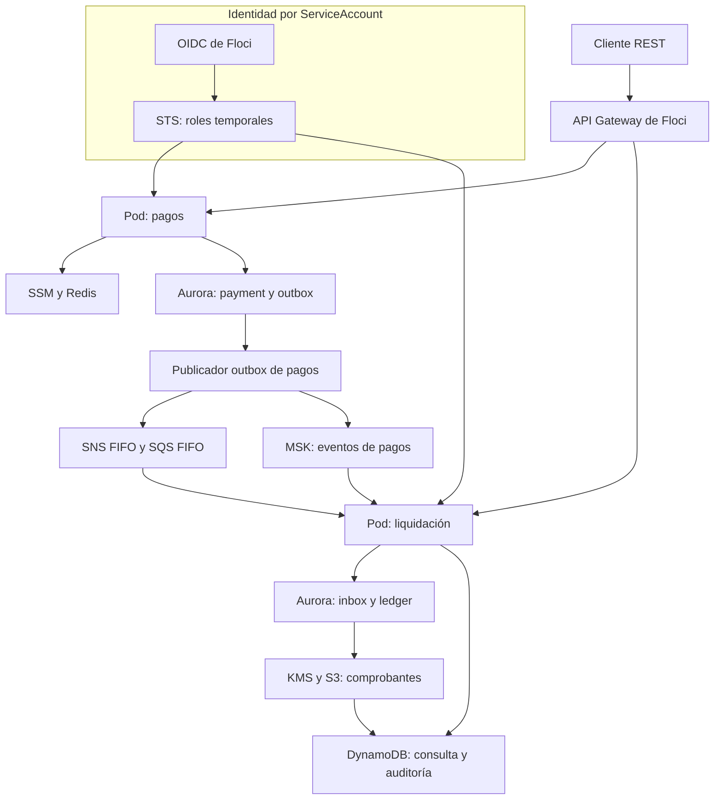

# Servicios AWS en local con Floci

Se implementa una plataforma de pagos en AWS local sobre Floci: 
se aprovisionan recursos mediante APIs AWS, se utilizan clientes AWS SDK reales y se separan las identidades de ejecución y los 
datos de cada contexto. Se prueban API Gateway, Aurora PostgreSQL, SNS/SQS, MSK, DynamoDB, S3, Secrets Manager, Parameter Store, 
ElastiCache Redis, EKS, IAM, STS, KMS y CloudWatch.

Se conservan **dos microservicios REST**: `payment-service` registra órdenes de pago y `settlement-service` procesa liquidación, 
comprobantes y auditoría. La separación permite comprobar comunicación asíncrona y permisos distintos sin añadir un servicio 
dedicado a simular fallos. `platform` es una biblioteca compartida; no se ejecuta ni despliega como servicio.

## Caso funcional

Se registra una orden tokenizada para un comercio y se consulta su límite operativo en Parameter Store, con caché Redis de 30 segundos. 
Se devuelve `ACCEPTED` cuando el monto cumple la política o `REJECTED` cuando supera el límite. Se utiliza `Idempotency-Key` para 
recuperar la misma operación sin generar eventos duplicados. El alcance financiero se limita al registro de órdenes y la contabilidad 
del laboratorio.

La decisión y dos entregas outbox se confirman en la misma transacción PostgreSQL. SNS/SQS transporta la orden hacia liquidación; 
MSK conserva el flujo para auditoría. En liquidación se registra inbox, se generan dos asientos balanceados para pagos aceptados y 
se prepara el comprobante. Los pagos rechazados reciben un comprobante sin asientos. Se firma el contenido con KMS, se publica en S3 
y se actualiza la proyección de consulta en DynamoDB.

## Servicios AWS locales mediante Floci

Se aprovisionan recursos mediante boto3 y se consumen mediante AWS SDK Java v2. Se conservan ARN, endpoints y región descubiertos en 
`.runtime/`. El uso de cada servicio se vincula al flujo de pagos o a su despliegue:

| Servicio AWS | Aplicación en la PoC | Comprobación |
|---|---|---|
| API Gateway HTTP API | Se enrutan las cinco operaciones públicas de pagos y liquidación | Se comprueba proxy HTTP, parámetros de ruta y reenvío de `X-Api-Key` |
| Aurora PostgreSQL mediante la API RDS | Se crean un cluster, dos usuarios y dos esquemas | Se comprueban tokens IAM, TLS `verify-full` y aislamiento SQL |
| IAM | Se crean roles y políticas por ServiceAccount y el proveedor OIDC local | Se restringen recursos, sujeto y audiencia de la identidad web |
| STS | Se asumen roles mediante identidad web, sin claves permanentes en las aplicaciones | Se consulta el rol efectivo y se rechaza el sujeto de otro servicio |
| EKS | Se despliegan dos ServiceAccounts, Deployments y Services en k3s administrado por Floci | Se consultan pods y el rol efectivo desde `/internal/platform` |
| SNS FIFO | Se publica la decisión del pago y se distribuye a la suscripción de liquidación | Se mantienen grupo y clave de deduplicación estables |
| SQS FIFO | Se consume la orden y se configura una cola de mensajes fallidos, DLQ | Se confirma después del commit; se configura la redirección tras cinco recepciones fallidas |
| MSK | Se publica Kafka con `acks=all` e idempotencia del productor | Se consulta una auditoría persistida por el consumidor con partición y offset |
| DynamoDB | Se materializan comprobantes y auditoría independiente | Se utiliza escritura condicional para impedir cambios del mismo evento |
| Secrets Manager | Se almacenan las claves de acceso a las APIs pública e interna | Se recuperan mediante el rol correspondiente |
| Systems Manager Parameter Store, SSM | Se almacena el límite operativo del comercio | Se permite su lectura a pagos y se deniega a liquidación |
| ElastiCache Redis | Se crea un replication group de un nodo para la caché de políticas | Se espera `available`; se consulta SSM si falla la caché |
| S3 | Se almacenan comprobantes versionados y metadatos de firma | Se recuperan los bytes publicados para verificar su integridad |
| KMS | Se crea una clave asimétrica y se firman comprobantes con RSA-PSS | Se verifica la firma del contenido almacenado en S3 |
| CloudWatch | Se envían métricas y se aprovisiona una alarma de volumen | Se consulta la configuración y se prueban permisos de publicación |
| API EC2: VPC y subredes | Se crean los recursos de red requeridos por EKS y MSK | Se reutilizan sus identificadores del plano de control; no se crean máquinas EC2 |

Se mantienen únicamente recursos asociados al flujo. Aurora cubre el almacenamiento relacional y se administra mediante la API RDS; 
no se crea otra instancia RDS. El flujo de auditoría se implementa con MSK. ECR permanece deshabilitado porque se importan imágenes 
locales en containerd. OIDC pertenece al mecanismo de identidad y no se contabiliza como otro servicio AWS. La VPC y las subredes 
representan recursos del plano de control emulado, sin reproducir aislamiento físico de red AWS.

## Arquitectura



API Gateway y las APIs AWS se emulan dentro de Floci. Floci crea contenedores reales para PostgreSQL, Redis y Redpanda; en el modo 
EKS también crea k3s. No se declara otro PostgreSQL, Redis o Kafka en Compose porque se duplicaría la infraestructura administrada por
el emulador. Secrets Manager y CloudWatch se consumen desde los dos servicios.

Se resuelve el broker MSK mediante las etiquetas Docker de servicio, recurso, cuenta y región en `axiz-network`. Se cruza la 
dirección devuelta por `GetBootstrapBrokers` con la inspección del contenedor y se conserva su nombre DNS, que Redpanda anuncia a 
los clientes Kafka. Se admiten nombres basados en identificadores de volumen, como `floci-msk-dfda92`, sin depender del nombre del clúster. Se rechaza la selección cuando el broker no existe, está detenido o resulta ambiguo.

## Tecnologías y versiones

| Tecnología | Versión | Uso |
|---|---|---|
| Java | 25; imagen Temurin `25.0.4.1_1` | Records, threads virtuales y compilación `release 25` |
| Spring Boot / Spring Framework | 4.1.1 / 7.0.9 | REST MVC, validación, configuración y ciclo de vida |
| Maven | 3.10.0 | Reactor y wrapper Linux con verificación SHA-512 |
| AWS SDK Java | 2.55.11 | Clientes AWS y credenciales de identidad web |
| Floci | 2.1.0 | Plano de control AWS y motores locales administrados |
| PostgreSQL / JDBC | 18.6 / 42.7.13 | Motor de Aurora emulado y conexiones IAM |
| Flyway | 12.4.0 | Migraciones por esquema durante bootstrap |
| Kafka client / Redpanda | 4.2.1 / 26.2.3 | Productor y consumidor del MSK emulado |
| Redis | 8.8.3 | Motor del ElastiCache emulado |
| k3s | 1.35.9-k3s1 | Kubernetes del EKS emulado |
| Jackson | 3.1.5 | JSON con la API `tools.jackson` de Spring Boot 4 |
| Spotless / Google Java Format | 3.0.0 / 1.33.0 | Formato Java comprobado durante `verify` |
| boto3 / psycopg | 1.43.108 / 3.3.6 | Aprovisionamiento y validación AWS/PostgreSQL |


## Estructura del proyecto

| Carpeta o archivo | Contenido |
|---|---|
| `payment-service/` | Dominio de órdenes, casos de uso, REST, PostgreSQL, SSM/Redis y publicador SNS/Kafka |
| `settlement-service/` | Dominio contable, consumidores SQS/Kafka, ledger, comprobantes S3/KMS y proyecciones DynamoDB |
| `platform/` | Biblioteca de identidad web, datasource IAM, filtros HTTP, métricas y catálogo de rutas |
| `infrastructura/` | Compose, imágenes base, bootstrap AWS, despliegue EKS, pruebas AWS y ejemplos JSON |
| `datasets/` | Pagos de ejemplo y precarga idempotente mediante la API |
| `scripts/` | Construcción, ejecución host, descubrimiento DNS, pruebas y rutas |
| `.env.example`, `application.yml.example` | Ejemplos de configuración y comentarios sobre los valores admitidos |
| `pom.xml`, `mvnw` | Reactor Maven importable en el IDE y lanzador Linux |


## Código principal

`PaymentService` valida la orden, calcula una huella SHA-256, recupera replays y evalúa la política del comercio. `JdbcPaymentStore.record` inserta pago y outbox en una transacción; la restricción única protege carreras con la misma clave. Un replay idéntico no vuelve a consultar SSM. La reutilización de la clave con otro contenido devuelve HTTP 409.

`OutboxPublisher` reserva entregas con `FOR UPDATE SKIP LOCKED`, libera la transacción antes de usar la red y confirma cada destino por separado. Se aplica una reserva temporal de 60 segundos y un reintento persistido con espera hasta 60 segundos. Un fallo de SNS no marca Kafka como confirmado ni elimina la decisión.

`SettlementConsumer` procesa SQS con visibilidad de 30 segundos. `JdbcLedger` confirma inbox, asientos y outbox de comprobante en una única transacción. La confirmación SQS se realiza después del commit. Se preserva el mensaje ante un fallo para reintento o DLQ.

`PaymentAuditConsumer` consume MSK con auto commit deshabilitado. `DynamoAuditStore` registra el evento con `attribute_not_exists(pk)`; un replay conserva su primera posición y un cambio de contenido se rechaza. Se confirma el offset después de persistir. Un fallo reposiciona la partición sin confirmar el registro; un evento inválido bloquea esa partición hasta su corrección operativa.

`ReceiptPublisher` firma exactamente los bytes del evento y publica la clave determinista `receipts/{paymentId}.json` con metadatos de firma. La tabla de proyección se actualiza antes de confirmar el outbox de comprobante. S3 puede conservar nuevas versiones durante una recuperación.

`AwsConfiguration` usa `StsWebIdentityTokenFileCredentialsProvider` con renovación asíncrona. `IamDataSource` genera un token RDS al crear cada conexión física; Hikari conserva conexiones, no una contraseña IAM estática. Se verifica la CA y el hostname con TLS. `DatabaseConfiguration` configura el esquema en Hikari: se ejecuta `Connection.setSchema` después de autenticar la conexión y se restaura ese esquema si se modifica durante un préstamo. Esta selección permite atravesar el proxy de Floci, que no transmite las opciones del mensaje inicial PostgreSQL. `PlatformIdentityController` consulta la identidad AWS y ejecuta `DatabaseIdentity.inspect` sobre una única conexión JDBC. Se devuelven el usuario, el esquema, `sslMode` leído de los metadatos de esa conexión abierta y `backendTls` obtenido de `pg_stat_ssl`; no se publica la URL JDBC ni sus credenciales. El driver exige `verify-full` al abrir cada conexión. El indicador del backend se informa por separado porque Floci termina TLS en su proxy.

## Preparación

```bash
sudo dnf install java-25-openjdk-devel python3 curl
docker version
docker compose version
cp .env.example .env
chmod +x mvnw scripts/*.sh datasets/*.sh
mkdir -p .runtime
```

## Imágenes base reutilizables

Compose construye primero una imagen Java que contiene las herramientas de descarga, Maven y las dependencias del reactor. Sólo se 
copian el wrapper y los POM en esa etapa, por lo que los cambios de código no invalidan la descarga de dependencias. Se construyen 
después las imágenes de herramientas y de los dos servicios. Se puede preparar este conjunto por separado:

```bash
bash scripts/build-base.sh
```

La imagen de herramientas contiene boto3, psycopg, Docker CLI, socat y las migraciones. Las imágenes de aplicación compilan offline 
sobre la base y ejecutan JRE con usuario no root. El paso separado es opcional cuando se utiliza `up --build`. Las imágenes `axiz-*` se construyen localmente; su política `pull_policy: never` evita búsquedas en Docker Hub. `--no-build` permite reutilizarlas después de una construcción completa. En EKS se importan las imágenes directamente en containerd; se deshabilita ECR en Floci porque el flujo no publica ni descarga imágenes desde ese registro.

Se importa el `pom.xml` raíz en el IDE y se selecciona JDK 25. La compilación local se realiza con:

```bash
./mvnw -B -ntp verify
```

## Ejecución en EKS administrado por Floci

Se utiliza este modo para comprobar las conexiones a Aurora desde pods y ServiceAccounts. En la primera ejecución, después de la 
preparación del entorno, se construyen las imágenes y se inicia la infraestructura y el despliegue en primer plano con un solo comando:

```bash
docker compose -f infrastructura/compose.yml -f infrastructura/compose.eks.yml --profile eks up --build
```

Se pueden reutilizar las imágenes existentes:

```bash
docker compose -f infrastructura/compose.yml -f infrastructura/compose.eks.yml --profile eks up --no-build
```

El bootstrap crea recursos AWS, CA, roles, esquemas y migraciones. Las tareas `payment-image` y `settlement-image` construyen las 
imágenes de aplicación y terminan sin iniciar JVM ni publicar puertos; el despliegue espera su finalización y la del bootstrap. 
`eks.py` comprueba la API Kubernetes y containerd, importa las imágenes locales en el namespace `k8s.io`, verifica sus referencias 
y recupera la identidad del nodo local. Se aplican después ServiceAccounts, Deployments y Services. Se completa el rollout de ambos 
Deployments antes de comprobar sus rutas de servicio; después se precargan pagos y se muestran las rutas. Se conserva el manifiesto 
aplicado en `.runtime/deployment.local.yml`. Se incluyen huellas de imagen y configuración en el pod para provocar un rollout al 
actualizar el código o la CA. Se utiliza nuevamente `up --build` para aplicar cambios de código o de la imagen base.

En Floci 2.1.0 se puede recrear el contenedor k3s al reiniciar, reutilizando su volumen. El hostname Docker cambia y los nodos anteriores permanecen en el datastore Kubernetes. Se verifica el contenedor mediante nombre, etiquetas de clúster, cuenta y región, imagen k3s y montaje del volumen esperado. `k3s_image` reconoce la referencia `rancher/k3s:` y consulta las etiquetas de la imagen cuando Docker conserva un ID SHA-256. Se espera hasta 60 segundos su registro como Node y hasta 180 segundos su condición `Ready`. Se retiran únicamente registros anteriores con la identidad Docker de k3s cuando su contenedor ya no existe; se inspeccionan también contenedores detenidos y se comprueba de nuevo el runtime antes de cada operación. La eliminación se protege con el UID del objeto Node. Se espera hasta 120 segundos la limpieza de los pods huérfanos mediante PodGC. Se conservan contenedores existentes, volúmenes y recursos AWS. Este procedimiento pertenece al proveedor local de un único nodo; una topología diferente detiene la recuperación para diagnóstico.

Se configura `RollingUpdate` con `maxUnavailable: 0`, `maxSurge: 1` y cinco segundos mínimos de readiness. Después del rollout se 
esperan, durante un máximo de 120 segundos, EndpointSlices con direcciones listas que no estén terminando y tres rondas consecutivas 
de readiness `UP` por ambos NodePorts, separadas por dos segundos. Se comprueba así la ruta HTTP que utilizará la precarga. Si falla el despliegue, se imprimen estado y descripción de nodos, pods, Services, EndpointSlices, eventos y los últimos logs de k3s. Se seleccionan explícitamente pods no terminantes del nodo actual para consultar logs de ambas aplicaciones. Se mantiene la salida de error y se conservan los recursos.

Los NodePorts pertenecen al contenedor k3s; Floci sólo publica directamente su API Kubernetes. El servicio Compose `eks-access` 
espera el despliegue y publica `127.0.0.1:30080` y `127.0.0.1:30081` mediante socat hacia los NodePorts en `axiz-network`. Se utiliza 
la misma imagen de herramientas, sin montar credenciales ni el socket Docker, con usuario sin privilegios y filesystem de sólo lectura. 
Se conserva el transporte TCP y se resuelve el nombre del nodo en cada conexión. Este acceso local permite ejecutar curl desde Fedora WSL, también con Docker Desktop; no representa un componente de AWS EKS. Las comprobaciones de salud del puente se ejecutan sin imprimir solicitudes periódicas en sus logs.

Se espera el estado `healthy` de `eks-access` antes de probar el flujo desde otra terminal:

```bash
docker compose -f infrastructura/compose.yml -f infrastructura/compose.eks.yml --profile eks ps eks-access
PAYMENT_URL=http://localhost:30080 SETTLEMENT_URL=http://localhost:30081 bash scripts/smoke.sh
```

Se utilizan `axiz-payment` y `axiz-settlement` en el namespace `axiz`. Cada trust policy exige 
`system:serviceaccount:axiz:<service-account>` y audiencia `sts.amazonaws.com`. Se limita `rds-db:connect` al recurso del cluster 
y al usuario de cada contexto. Las aplicaciones no reciben claves AWS permanentes ni la contraseña de administración SQL.

**Particularidad de Floci:** se obtiene el JWT firmado del endpoint OIDC local del emulador mediante un init container y un renovador. 
Se utilizan el ServiceAccount y namespace efectivos del pod mediante Downward API y un volumen en memoria. Este emisor local no atesta 
la identidad de un pod AWS real. La adaptación a AWS EKS utiliza tokens proyectados de Kubernetes; se incluye 
`infrastructura/kubernetes/aws-irsa-patch.yml` como base de esa adaptación. Se requieren ARN, endpoints, CA e imágenes 
publicados en el entorno AWS real.

```bash
docker exec floci-eks-axiz-payments /bin/kubectl --kubeconfig /etc/rancher/k3s/k3s.yaml -n axiz get pods
docker exec floci-eks-axiz-payments /bin/kubectl --kubeconfig /etc/rancher/k3s/k3s.yaml -n axiz logs deployment/axiz-payment -c payment
```

## Ejecución completa con Compose

Se inicia infraestructura, aplicaciones, migraciones, renovación de identidad, precarga y rutas en un solo comando:

```bash
docker compose -f infrastructura/compose.yml --profile full up --build
```

Se reutilizan las imágenes sin compilación con:

```bash
docker compose -f infrastructura/compose.yml --profile full up --no-build
```

En esta modalidad EKS mantiene metadatos y emisión OIDC para el laboratorio; no se crean pods. Los servicios se ejecutan en Compose 
con roles temporales. El archivo del modo EKS activa el motor Kubernetes real.

## Infraestructura en Compose y aplicaciones en host

Se mantiene la infraestructura en primer plano en una terminal:

```bash
docker compose -f infrastructura/compose.yml -f infrastructura/compose.host.yml up --build
```

Después del mensaje de aprovisionamiento completado, se utiliza otra terminal para registrar el broker anunciado e iniciar los dos 
servicios:

```bash
sudo bash scripts/host-dns.sh
bash scripts/run-host.sh
```

`run-host.sh` compila, inicia las JVM, precarga pagos, muestra rutas y finaliza ambos procesos al recibir una interrupción. Se
mantiene el renovador de identidad de Compose en ejecución. Si se reutilizan imágenes de infraestructura se sustituye `--build` por
`--no-build`.

## Migraciones y precarga

Flyway mantiene una historia independiente por esquema. El bootstrap crea usuarios y esquemas y ejecuta las migraciones como propietario. Se invoca el plugin mediante `org.flywaydb:flyway-maven-plugin:migrate`; su versión se obtiene del POM y se utiliza `-o` para resolver las dependencias ya preparadas en la imagen base. Se evita consultar feeds de terceros durante el arranque. Los usuarios de aplicación reciben DML y uso de secuencias; se revoca el acceso a la historia Flyway y no se habilita creación de tablas. `datasets` no repite DDL ni migraciones.

Se precargan tres órdenes aceptadas del comercio `merchant-demo`, con claves de idempotencia estables. Se conserva el resultado en `.runtime/dataset-results.json`. Se puede repetir la precarga desde la raíz:

```bash
bash datasets/seed.sh
```

En EKS se utiliza:

```bash
bash datasets/seed.sh http://localhost:30080
```

La precarga espera readiness hasta 240 segundos y limita cada POST a una ventana total de 120 segundos, con hasta 15 segundos por 
solicitud y espera progresiva de uno a cinco segundos. Se reintentan cortes de conexión, timeouts y respuestas HTTP 408, 429, 500, 
502, 503 y 504 conservando exactamente la clave de idempotencia y el cuerpo originales. Si el pago se confirmó antes de perder la 
respuesta, se recupera por replay. Un HTTP 400, 401, 403, 404, 409 o 422, un certificado inválido o una respuesta mal formada detienen 
la carga. Se reemplaza el archivo de resultados de forma atómica únicamente después de confirmar todos los pagos como `ACCEPTED`; una
carga parcial conserva el resultado anterior y puede recuperarse con las mismas claves.

Se utiliza un volumen `floci-data-v2` para este modelo. Al sustituir una versión anterior se detiene primero su stack y se utiliza un 
despliegue nuevo; no se aplica este esquema inicial sobre la historia Flyway anterior.

## Endpoints en orden del flujo

| Método y ruta | Servicio | Función | Descripción técnica |
|---|---|---|---|
| `GET /actuator/health/readiness` | Ambos | Comprobar arranque | Actuator, sin detalles internos |
| `GET /internal/platform` | Ambos | Comprobar rol y conexión a Aurora | STS, `current_user`, esquema, modo TLS del cliente y TLS del backend; `X-Internal-Key` |
| `POST /api/payments` | Pagos | Registrar una orden | `X-Api-Key`, `Idempotency-Key`; decisión y outbox atómicos; HTTP 200 |
| `GET /api/payments/{id}` | Pagos | Consultar la orden | Lectura PostgreSQL; `X-Api-Key` |
| `GET /api/settlements/{id}` | Liquidación | Consultar comprobante | Lectura consistente DynamoDB; 404 mientras se materializa |
| `GET /api/settlements/{id}/ledger` | Liquidación | Consultar asientos | Lectura del esquema propio; array vacío para rechazo |
| `GET /api/settlements/{id}/audit` | Liquidación | Consultar auditoría MSK | DynamoDB con payload original, partición y offset |
| `GET /internal/outbox` | Pagos | Revisar entregas SNS/Kafka | Totales y pendientes por destino; `X-Internal-Key` |
| `GET /internal/settlement/backlog` | Liquidación | Revisar pendientes | Conteos inbox y comprobantes; `X-Internal-Key` |
| `GET /actuator/health/liveness` | Ambos | Comprobar vida del proceso | Sonda independiente del negocio |
| `GET /actuator/metrics` | Ambos | Consultar métricas | Micrometer; se consulta una métrica en `/actuator/metrics/{nombre}` |
| `GET /actuator/prometheus` | Ambos | Exportar métricas | Texto Prometheus, sin desplegar otro servidor |
| `GET /actuator/info` | Ambos | Consultar metadatos Actuator | HTTP 200; objeto vacío si no hay contribuciones configuradas |
| `GET /routes` | Ambos | Listar rutas al terminar el arranque | Catálogo de mappings REST |
| `/error` | Ambos | Gestionar errores HTTP | Handler automático de Spring Boot; mappings HTML y general |

Las rutas `/api/settlements/**` requieren `X-Api-Key`. Los puertos host/Compose son 8080 y 8081; los NodePorts EKS se publican en 
localhost mediante `eks-access` en 30080 y 30081. API Gateway publica las cinco rutas `/api/**` de la tabla. Se utilizan `X-Api-Key` y `X-Internal-Key` cargadas desde Secrets Manager al inicio; su rotación requiere reiniciar los servicios. Se propaga `X-Correlation-Id` o se genera un UUID cuando falta.

## Pruebas por curl

Se preparan las rutas para host/Compose y se cargan las claves generadas:

```bash
payment=http://localhost:8080
settlement=http://localhost:8081
api_key=$(cat .runtime/api-key)
internal_key=$(cat .runtime/internal-key)
key="curl-$(date +%s%N)"
```

En EKS se seleccionan las rutas locales publicadas por `eks-access`:

```bash
payment=http://localhost:30080
settlement=http://localhost:30081
```

### Identidad efectiva y conexión SQL

Se consulta STS con el rol del servicio y se comprueba la sesión PostgreSQL. El request no tiene body:

```bash
curl -fsS "$payment/internal/platform" -H "X-Internal-Key: $internal_key"
```

Se devuelve una respuesta equivalente a:

```json
{"awsRole":"arn:aws:sts::000000000000:assumed-role/axiz-payment/payment-service","account":"000000000000","database":{"username":"axiz_payment","schema":"payment","sslMode":"verify-full","backendTls":false}}
```

`sslMode: verify-full` corresponde al modo del driver de la conexión abierta: se exige cifrado y se validan la CA y el hostname 
durante el login. `backendTls` corresponde al tramo visto por PostgreSQL. En Floci se espera `false` porque el proxy termina TLS 
antes de conectarse al motor local. Se verifica el tramo cliente desde libpq mediante `connection.pgconn.ssl_in_use` en 
`verify_aws.py`, manteniendo `verify-full`, y se selecciona el esquema después del login IAM. Se conserva el aislamiento SQL entre 
servicios.

### Registro e idempotencia

Se registra una orden conforme al límite del comercio:

```bash
result=$(curl -fsS -X POST "$payment/api/payments" \
  -H "X-Api-Key: $api_key" -H "Idempotency-Key: $key" \
  -H 'Content-Type: application/json' -d @infrastructura/requests/payment.json)
printf '%s\n' "$result"
id=$(printf '%s' "$result" | python3 -c 'import json,sys; print(json.load(sys.stdin)["id"])')
```

El request contiene `merchantId`, `amount`, `currency` y `token`. Se devuelve HTTP 200:

```json
{"id":"cb5f377e-80db-4d35-aea6-c0acbe7e2d2e","merchantId":"merchant-demo","amount":25.50,"currency":"PEN","status":"ACCEPTED","reason":"POLICY_ACCEPTED"}
```

Se repite exactamente el request para obtener el mismo identificador y conservar una sola decisión y dos entregas outbox:

```bash
curl -fsS -X POST "$payment/api/payments" \
  -H "X-Api-Key: $api_key" -H "Idempotency-Key: $key" \
  -H 'Content-Type: application/json' -d @infrastructura/requests/payment.json
```

Se modifica el monto manteniendo la clave para comprobar HTTP 409:

```bash
curl -sS -i -X POST "$payment/api/payments" \
  -H "X-Api-Key: $api_key" -H "Idempotency-Key: $key" \
  -H 'Content-Type: application/json' \
  -d '{"merchantId":"merchant-demo","amount":26.00,"currency":"PEN","token":"tok_demo"}'
```

Se devuelve un ProblemDetail con `status: 409` y detalle de reutilización de la clave. Un campo inválido produce 400; una indisponibilidad AWS/SQL durante el registro produce 503 y no se confirma una orden incompleta.

### Acceso a través de API Gateway

Se utiliza el host virtual de Floci para seleccionar la API. El request GET no tiene body y devuelve la misma orden:

```bash
curl -fsS "http://localhost:4566/api/payments/$id" \
  -H 'Host: axiz-payments.execute-api.localhost.floci.io' -H "X-Api-Key: $api_key"
```

### Liquidación, comprobante y auditoría

Se consulta la proyección después del procesamiento asíncrono. El request GET no tiene body; mientras se procesa se puede recibir 404:

```bash
curl -fsS "$settlement/api/settlements/$id" -H "X-Api-Key: $api_key"
curl -fsS "$settlement/api/settlements/$id/ledger" -H "X-Api-Key: $api_key"
curl -fsS "$settlement/api/settlements/$id/audit" -H "X-Api-Key: $api_key"
```

La proyección devuelve `pk`, `status`, `amount`, `currency` y `receiptKey`. El ledger devuelve dos entradas `PAYMENT_CLEARING` y 
`MERCHANT_PAYABLE`, con importes 25.50 y -25.50 y suma cero. La auditoría devuelve `eventId`, `payload`, `partition` y `offset`; se conserva el contenido original publicado en MSK.

### Rechazo por política

Se registra un importe superior al límite inicial 5000.00 mediante una clave nueva:

```bash
curl -fsS -X POST "$payment/api/payments" \
  -H "X-Api-Key: $api_key" -H "Idempotency-Key: rejected-$key" \
  -H 'Content-Type: application/json' -d @infrastructura/requests/payment-rejected.json
```

Se devuelve HTTP 200 con `status: REJECTED` y `reason: MERCHANT_LIMIT_EXCEEDED`. Se generan comprobante y auditoría; la consulta de ledger devuelve `[]`.

### Pendientes y autenticación

Se inspecciona el procesamiento sin modificar datos. Los requests GET no tienen body:

```bash
curl -fsS "$payment/internal/outbox" -H "X-Internal-Key: $internal_key"
curl -fsS "$settlement/internal/settlement/backlog" -H "X-Internal-Key: $internal_key"
curl -sS -i "$payment/internal/platform"
curl -sS -i "$payment/api/payments/$id"
```

Se devuelven conteos de pendientes en las dos primeras operaciones y HTTP 401 en las consultas sin clave. El outbox devuelve destinos `SNS` y `KAFKA`, `total` y `pending`; el backlog devuelve `pendingReceipts` e `inbox`.

## Conjunto completo de pruebas

El smoke confirma el flujo REST y su integración entre servicios. Para comprobar además persistencia transaccional, permisos negativos y firmas se ejecuta el conjunto completo desde la raíz, con Floci, aplicaciones y precarga disponibles. Se requiere JDK 25 y Python 3 en el host, además de curl y un daemon Docker accesible: Maven se ejecuta en el host incluso cuando los servicios están desplegados en EKS. Testcontainers inicia PostgreSQL temporal para las pruebas de los adaptadores, separado del cluster Aurora del laboratorio.

`scripts/test.sh all` no ejecuta `docker compose up` ni reconstruye las imágenes de aplicación. Se mantiene el despliegue en primer plano en una terminal y se ejecutan las pruebas en otra. Las comprobaciones de infraestructura y AWS utilizan contenedores temporales de herramientas mediante `docker compose run --rm`; Testcontainers retira sus propios contenedores al finalizar.

Para el modo completo de Compose o la ejecución de las aplicaciones en el host:

```bash
bash scripts/test.sh all
```

Para EKS se utilizan las rutas locales publicadas por `eks-access`:

```bash
PAYMENT_URL=http://localhost:30080 SETTLEMENT_URL=http://localhost:30081 bash scripts/test.sh all
```

Se ejecutan las comprobaciones en este orden; cualquier fallo detiene el script con salida distinta de cero:

| Etapa | Alcance técnico y funcional | Resultado esperado |
|---|---|---|
| Maven `verify` | Compilación y Spotless; 30 pruebas de dominio, configuración de conexiones y diagnóstico TLS; 4 pruebas PostgreSQL de idempotencia, balance y rollback; 8 pruebas AWS SDK de SNS, KMS, DynamoDB, SSM, Secrets Manager y permisos entre roles | `BUILD SUCCESS`, con las 42 pruebas Java aprobadas y ninguna omitida en el modo `all` |
| Sintaxis Python y shell | Se compilan los módulos Python y se comprueba la sintaxis de los scripts | Se continúa sin errores |
| Pruebas de infraestructura | 74 pruebas del aprovisionador, recuperación MSK/EKS, acceso NodePort, precarga e identidad | Se informa `Ran 74 tests` y `OK` |
| `smoke.sh` | Registro, replay, conflicto HTTP 409, rechazo por límite, liquidación, balance contable, auditoría MSK, identidad de ambos servicios, acceso anónimo denegado y proxy API Gateway | Se imprimen todas las comprobaciones y el catálogo final de rutas |
| `verify_aws.py` | STS y sujeto OIDC; permisos cruzados denegados; conexión física Aurora con token IAM y TLS `verify-full`; aislamiento SQL; entrega y confirmación SNS/SQS; verificación KMS de los bytes precargados en S3 | `Se completaron las verificaciones Floci.` |

Se puede ejecutar sólo compilación y pruebas sin infraestructura:

```bash
bash scripts/test.sh
```

La suite AWS SDK se activa con `RUN_FLOCI_IT=true` y la PostgreSQL con `RUN_POSTGRES_IT=true`; el modo `all` activa ambas. En la ejecución sin infraestructura se omiten esas 12 pruebas. La verificación AWS se ejecuta en la imagen de herramientas y no requiere instalar AWS CLI. Se pueden repetir únicamente las comprobaciones de roles, Aurora, SNS/SQS y firmas, también en el modo EKS:

```bash
docker compose -f infrastructura/compose.yml run --rm --no-deps bootstrap python3 infrastructura/verify_aws.py
```

Se comprueba la recuperación de creaciones lentas y respuestas perdidas con el SDK boto3 real contra un servidor HTTP local de prueba. Se verifica una sola solicitud de creación, la reconciliación posterior por lectura, la espera limitada y el rechazo inmediato de errores de permisos. Las 74 pruebas de infraestructura se ejecutan al construir la imagen de herramientas y durante `scripts/test.sh all`. Se pueden repetir con la imagen de herramientas ya construida, sin iniciar Floci:

```bash
docker compose -f infrastructura/compose.yml run --rm --no-deps bootstrap python3 -m unittest discover -s infrastructura/tests -v
```

## Operación

Se muestran las rutas al final del arranque o mediante:

```bash
bash scripts/routes.sh
```

En EKS se utiliza:

```bash
PAYMENT_URL=http://localhost:30080 SETTLEMENT_URL=http://localhost:30081 bash scripts/routes.sh
```

No se habilita access logging de sondas HTTP ni se imprime el health check de forma continua. Los logs operativos se consultan cuando se necesita diagnosticar un fallo:

```bash
docker compose -f infrastructura/compose.yml logs bootstrap
docker compose -f infrastructura/compose.yml logs payment settlement
```